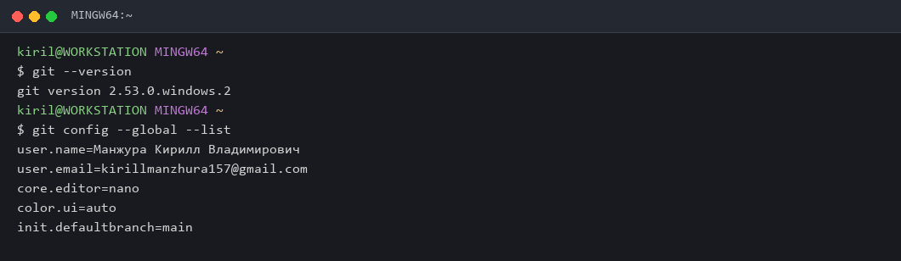
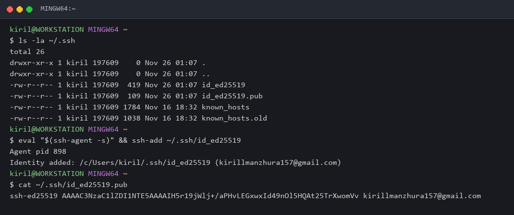
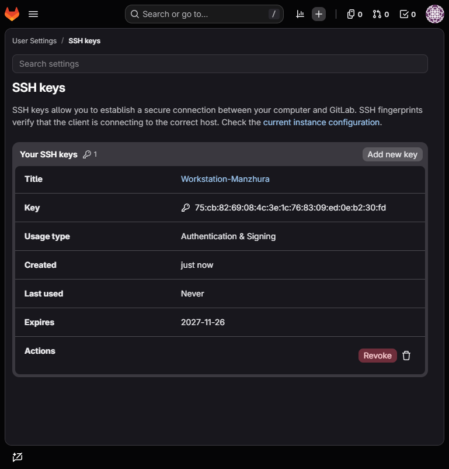
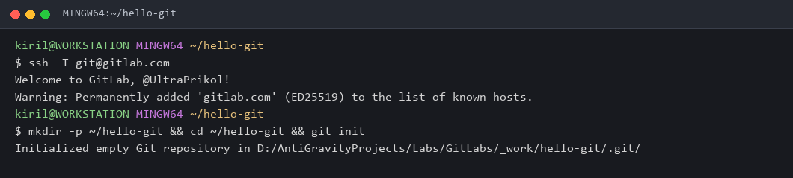
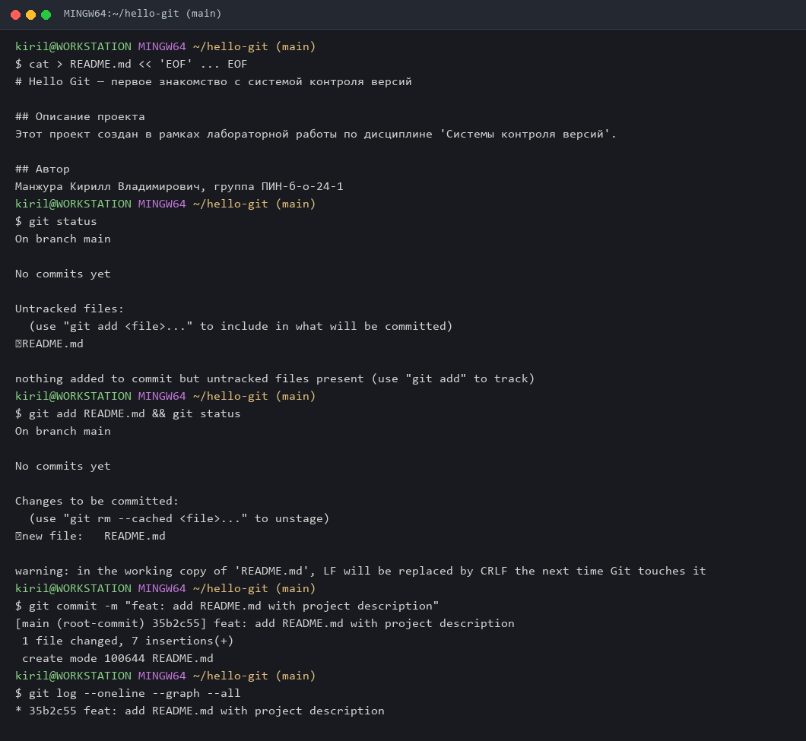
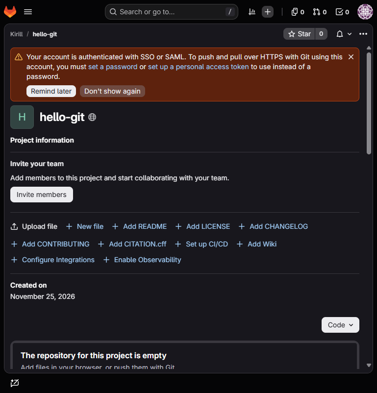
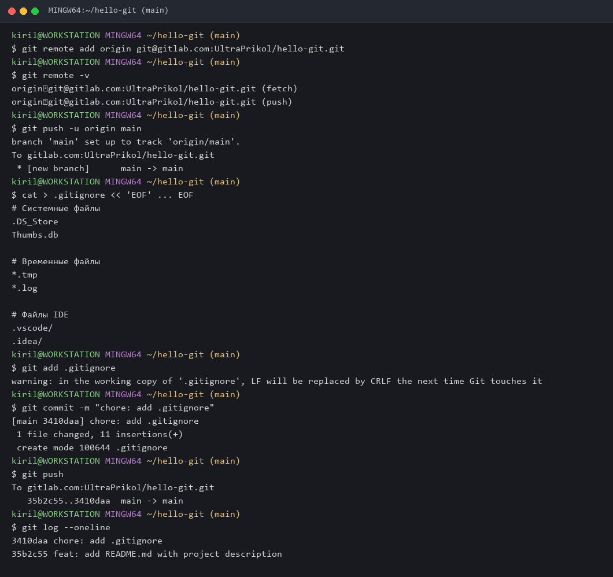
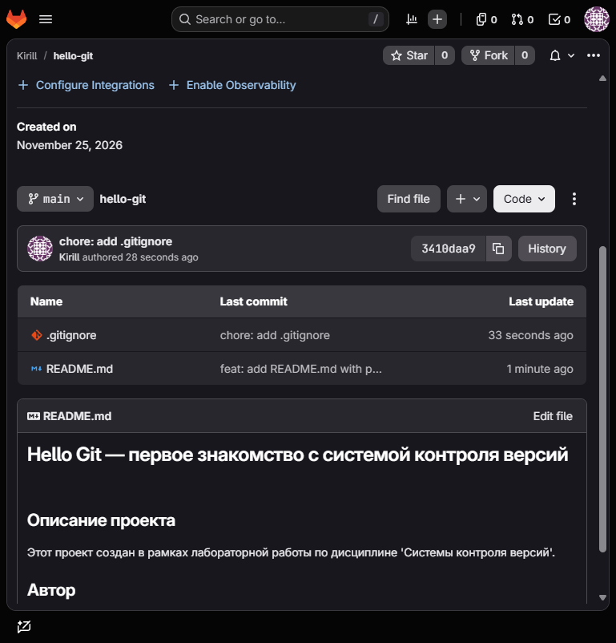
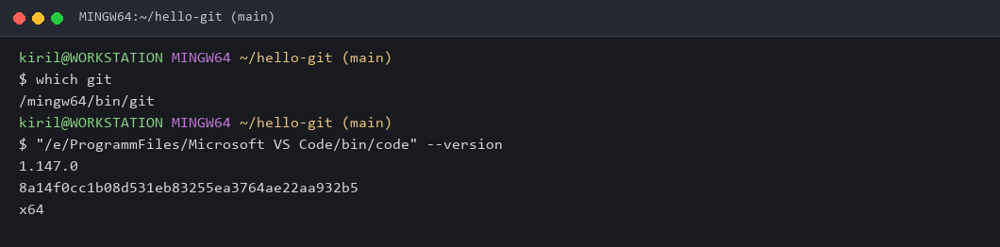

# Отчет по лабораторной работе 0102
# Лабораторная работа 1: Установка и настройка Git, создание SSH-ключа, работа с GitLab

**Дата:** 2026-09-04
**Семестр:** 5
**Группа:** ПИН-б-о-24-1
**Дисциплина:** Системы управления версий
**Студент:** Манжура Кирилл Владимирович

## 1. Цель работы

1. Установить и настроить систему контроля версий Git в рабочем окружении.
2. Создать SSH-ключ для безопасного подключения к GitLab.
3. Войти в профиль на GitLab и добавить публичный SSH-ключ в настройки аккаунта.
4. Создать локальный репозиторий, выполнить базовые операции (`init`, `add`, `commit`, `status`, `log`).
5. Проверить интеграцию Git с VS Code.
6. Создать удалённый репозиторий на GitLab и загрузить проект (`push`), а также настроить файл `.gitignore`.

---

## 2. Требования к окружению

| Компонент | Версия / Источник |
|:---|:---|
| **Операционная система** | Windows 11 (терминал Git Bash / MINGW64; методические шаги Debian адаптированы под Git Bash) |
| **Git** | `git version 2.53.0.windows.2` |
| **OpenSSH** | `OpenSSH_10.2p1, OpenSSL 3.5.5` |
| **VS Code** | `1.147.0` (`8a14f0cc1b08d531eb83255ea3764ae22aa932b5`, x64) |
| **GitLab** | Аккаунт `@UltraPrikol` на `gitlab.com` |

---

## 3. Теоретическое введение

### 3.1. Что такое Git?
Git — распределённая система контроля версий, разработанная Линусом Торвальдсом в 2005 году. Она позволяет сохранять историю изменений кода, работать с несколькими ветками параллельно, синхронизироваться с удалёнными серверами и организовать совместную разработку.

### 3.2. SSH-аутентификация в GitLab
SSH (Secure Shell) обеспечивает криптографически защищённое подключение к удалённому серверу без ввода логина и пароля при каждом `git push` или `git pull`. Для аутентификации используется асимметричная пара ключей: приватный ключ (`~/.ssh/id_ed25519`) хранится локально, а публичный (`~/.ssh/id_ed25519.pub`) добавляется в профиль GitLab.

### 3.3. Роль GitLab
GitLab — комплексная DevOps-платформа, объединяющая хостинг Git-репозиториев, инструменты Code Review (Merge Requests), встроенный CI/CD, трекер задач, Wiki и механизмы защиты веток.

---

## 4. Ход выполнения работы

### Часть 1 — Установка, настройка Git и SSH-ключ

#### Шаг 1–2. Проверка установки Git и настройка профиля пользователя

Проверена версия установленного Git и настроены глобальные параметры пользователя (`user.name`, `user.email`, редактор `nano`, цветной вывод `color.ui`, ветка по умолчанию `main`):

```bash
git --version
git config --global user.name "Манжура Кирилл Владимирович"
git config --global user.email "kirillmanzhura157@gmail.com"
git config --global core.editor nano
git config --global color.ui auto
git config --global init.defaultBranch main
git config --global --list
```



#### Шаг 3–4. Генерация SSH-ключа `ed25519` и запуск `ssh-agent`

Сгенерирована пара ключей алгоритмом `ed25519` (отпечаток `SHA256:uSCE049J0BiBo7sZUZw3FpRKZ2edbX62HswIz1AMzl8`), запущен `ssh-agent` и добавлен приватный ключ:

```bash
ssh-keygen -t ed25519 -C "kirillmanzhura157@gmail.com"
ls -la ~/.ssh
eval "$(ssh-agent -s)" && ssh-add ~/.ssh/id_ed25519
cat ~/.ssh/id_ed25519.pub
```



#### Шаг 5–6. Авторизация на GitLab и добавление SSH-ключа

Выполнена авторизация в аккаунте `@UltraPrikol` на `gitlab.com`. В разделе **Preferences → SSH Keys** добавлен публичный ключ с названием `Workstation-Manzhura` (`Authentication & Signing`).



#### Шаг 7–8. Проверка SSH-подключения и инициализация локального репозитория

Проверено подключение к GitLab по SSH (`Welcome to GitLab, @UltraPrikol!`) и инициализирован репозиторий `hello-git`:

```bash
ssh -T git@gitlab.com
mkdir -p ~/hello-git && cd ~/hello-git && git init
```



---

### Часть 2 — Создание репозитория и работа с Git

#### Шаг 9–11. Создание `README.md`, индексация, первый коммит и просмотр истории

Создан файл `README.md` с описанием проекта и данными автора, выполнена проверка состояния (`git status`), добавление в индекс (`git add`), первый коммит (`35b2c55`) и просмотр истории (`git log --oneline --graph --all`):

```bash
git status
git add README.md
git status
git commit -m "feat: add README.md with project description"
git log --oneline --graph --all
```



#### Шаг 12. Создание удалённого репозитория на GitLab

На GitLab создан новый пустой публичный проект `hello-git` (`https://gitlab.com/UltraPrikol/hello-git`) без автоматической инициализации `README.md`.



#### Шаг 13–14 и раздел 5. Связывание с `origin`, `.gitignore` и отправка изменений (`push`)

Удалённый репозиторий привязан как `origin`, ветка `main` отправлена на сервер (`git push -u origin main`), после чего добавлен файл `.gitignore` (исключение `.DS_Store`, `Thumbs.db`, `*.tmp`, `*.log`, `.vscode/`, `.idea/`), выполнен коммит `3410daa` (`chore: add .gitignore`) и повторный `git push`.



В веб-интерфейсе GitLab подтверждено отображение файлов `README.md` и `.gitignore` в репозитории `UltraPrikol/hello-git`:



#### Шаг 15–16. Проверка интеграции с VS Code

Проверен путь к исполняемому файлу Git (`which git` → `/mingw64/bin/git`) и версия установленного редактора VS Code (`1.147.0`).



---

## 5. Ответы на контрольные вопросы

1. **Что такое распределённая система контроля версий и чем она отличается от централизованной?**  
   В централизованной СКВ (например, SVN, CVS) полная история изменений хранится только на одном сервере, а клиенты получают снимок рабочей копии и зависят от сети для большинства операций. В распределённой СКВ (Git) каждый разработчик имеет полную локальную копию репозитория со всей историей коммитов, ветками и тегами, что позволяет коммитить, переключать ветки и смотреть историю автономно, а затем синхронизироваться с любыми удалёнными узлами.

2. **Для чего нужен SSH-ключ при работе с GitLab?**  
   SSH-ключ обеспечивает безопасную криптографическую аутентификацию пользователя при обмене данными с сервером (`git clone`, `git fetch`, `git push`) без необходимости каждый раз вводить логин и пароль или передавать их в открытом виде.

3. **В чём разница между `git add` и `git commit`?**  
   `git add` переносит изменения из рабочей директории (working directory) в промежуточную область индексации (staging area), формируя состав будущего снимка. `git commit` фиксирует проиндексированные изменения в базе объектов Git в виде нового неизменяемого коммита с хешем, автором, датой и сообщением.

4. **Что такое staging area (индекс) в Git?**  
   Staging area (индекс) — это промежуточная область (файл `.git/index`), в которой подготавливается следующий коммит. Она позволяет включать в коммит не все изменённые файлы сразу, а логически связанные части изменений, разбивая работу на атомарные коммиты.

5. **Как проверить, какие файлы были изменены, но ещё не добавлены в коммит?**  
   С помощью команды `git status` (показывает изменённые, проиндексированные и неотслеживаемые файлы) и `git diff` (показывает построчную разницу в рабочей директории относительно индекса; для проиндексированных изменений используется `git diff --staged`).

6. **Для чего нужен файл `.gitignore`? Приведите примеры.**  
   Файл `.gitignore` указывает Git, какие файлы и каталоги не нужно отслеживать и добавлять в репозиторий (временные файлы, секреты, зависимости, артефакты сборки, настройки IDE). Примеры шаблонов: `*.log`, `*.tmp`, `.env`, `.vscode/`, `node_modules/`, `__pycache__/`.

7. **Как связать локальный репозиторий с удалённым?**  
   Командой `git remote add <имя> <URL>`, например `git remote add origin git@gitlab.com:UltraPrikol/hello-git.git`, после чего отправить ветку и привязать её к отслеживаемой ветке командой `git push -u origin main`.

8. **Чем отличается `git fetch` от `git pull`?**  
   `git fetch` скачивает новые коммиты, ветки и теги с удалённого репозитория в локальные удалённо-отслеживаемые ветки (например, `origin/main`), не изменяя рабочие файлы и текущую ветку. `git pull` выполняет `git fetch`, а затем сразу сливает (`merge` или `rebase`) полученные изменения в текущую локальную ветку.

---

## 6. Выводы

В ходе лабораторной работы №1 был настроен Git (`2.53.0`) с данными пользователя, сгенерирован SSH-ключ `ed25519` и добавлен в профиль GitLab `@UltraPrikol`. Создан локальный репозиторий `hello-git`, оформлены `README.md` и `.gitignore`, выполнены базовые операции (`init`, `add`, `commit`, `log`, `remote add`, `push`) и проверена отображаемость файлов на `gitlab.com`.
