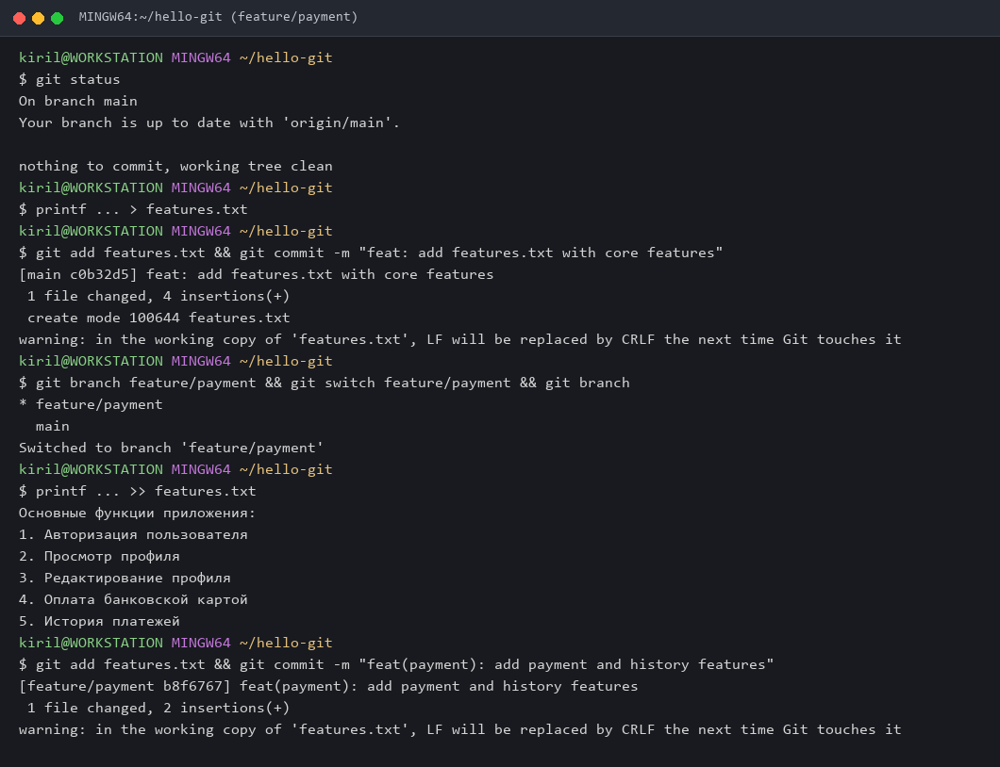
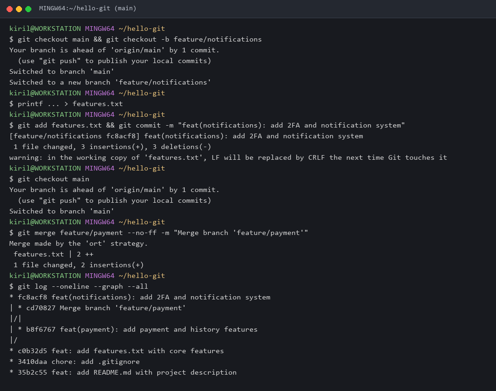
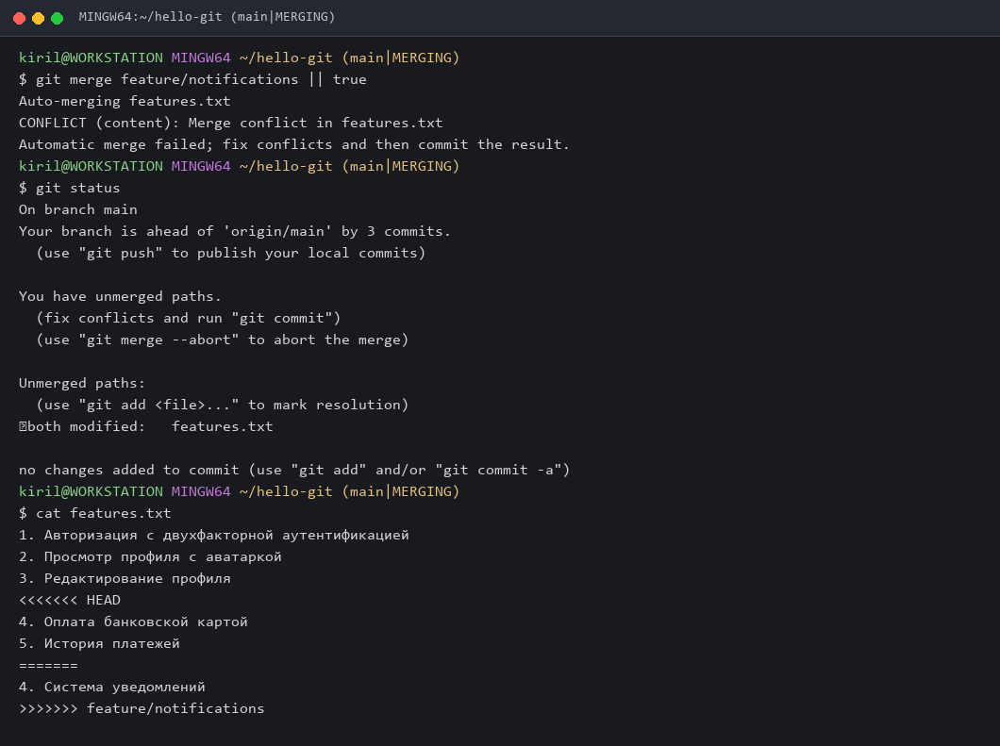
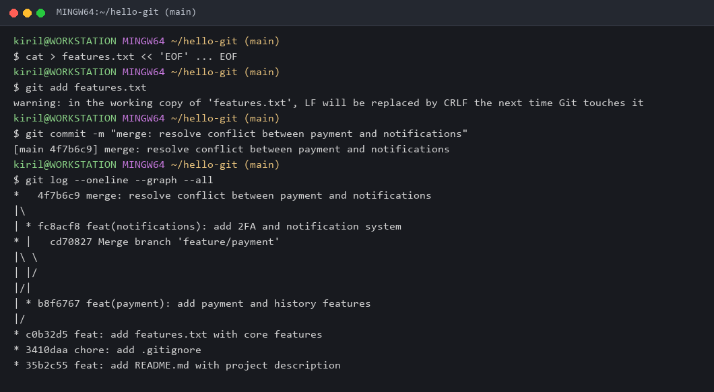
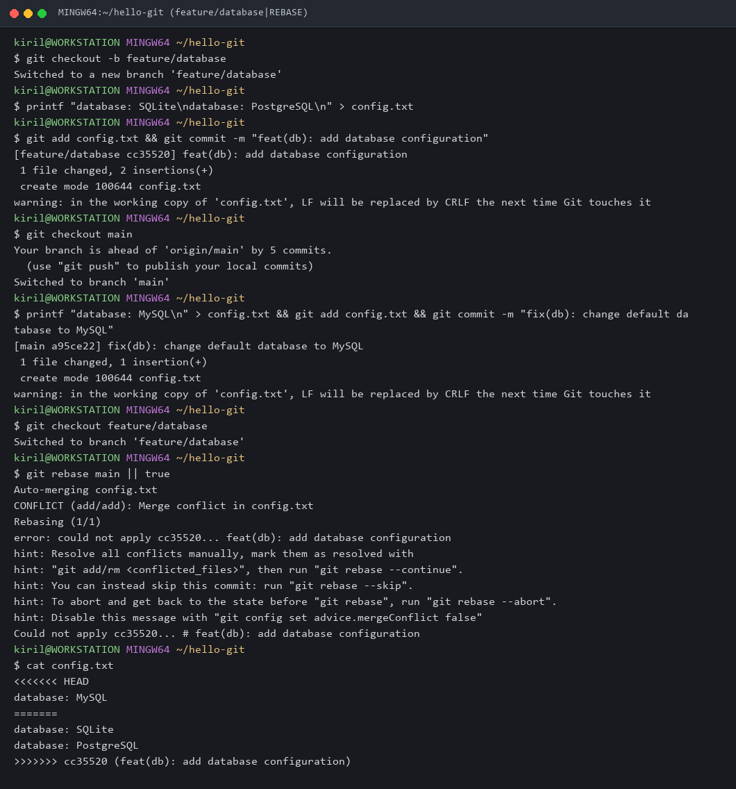
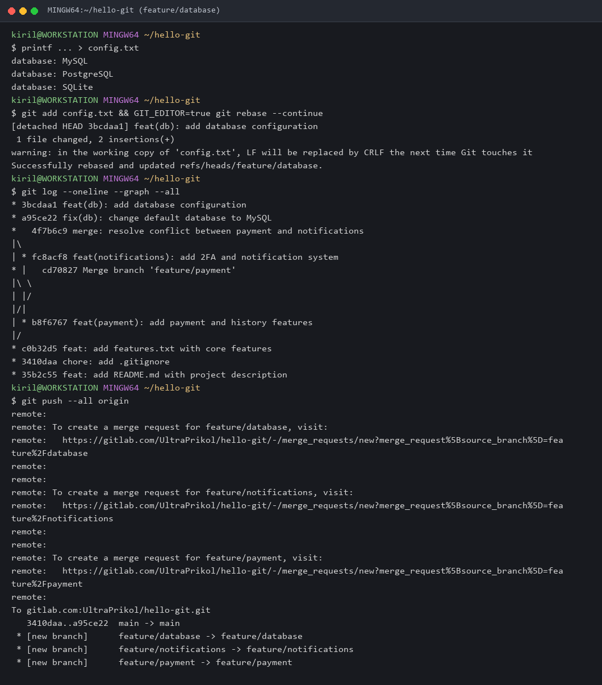
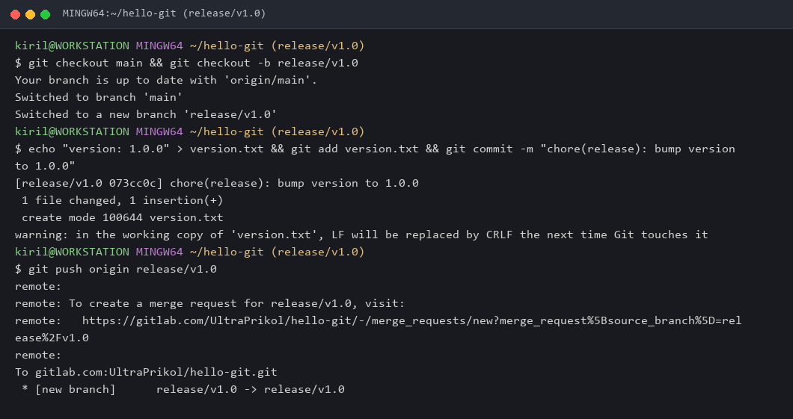
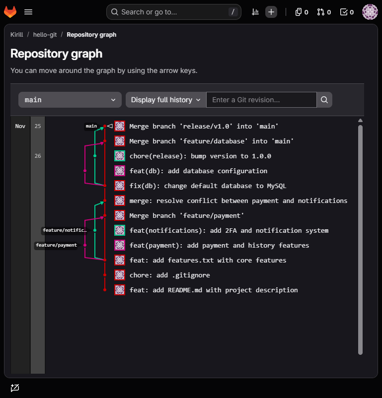
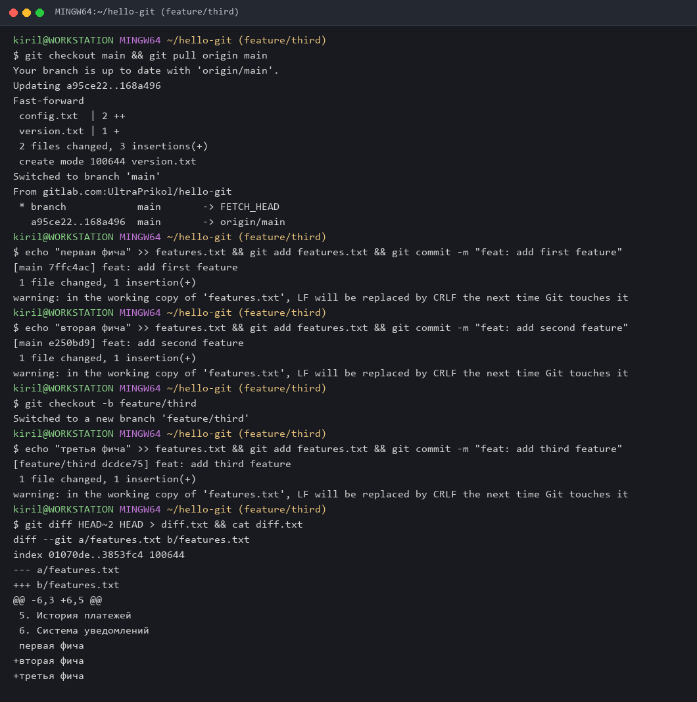
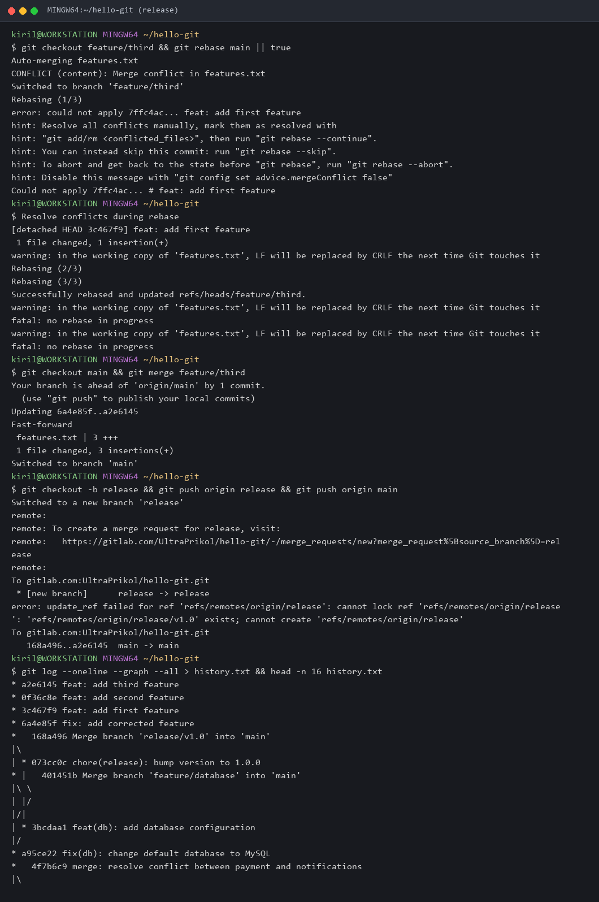

# Отчет по лабораторной работе 0202
# Лабораторная работа 2: Ветвление, слияние и разрешение конфликтов в Git

**Дата:** 2026-09-11
**Семестр:** 5
**Группа:** ПИН-б-о-24-1
**Дисциплина:** Системы управления версий
**Студент:** Манжура Кирилл Владимирович

## 1. Цель работы

1. Освоить работу с ветками в Git: создание, переключение, удаление.
2. Научиться выполнять слияние веток (`git merge`) в сценариях fast-forward и трёхстороннего слияния (`--no-ff`).
3. Изучить механизм возникновения конфликтов слияния и освоить их ручное разрешение.
4. Познакомиться с перебазированием (`git rebase`), разрешением конфликтов при rebase и сравнить его со слиянием.
5. Закрепить навыки работы с удалённым репозиторием GitLab (отправка веток, Merge Requests) и выполнить комплексное задание.

---

## 2. Требования к окружению

| Компонент | Версия / Источник |
|:---|:---|
| **Операционная система** | Windows 11 (Git Bash / MINGW64) |
| **Git** | `git version 2.53.0.windows.2` |
| **GitLab** | Репозиторий `UltraPrikol/hello-git` на `gitlab.com` |

---

## 3. Теоретическое введение

### 3.1. Ветки в Git
Ветка в Git представляет собой лёгкий подвижный указатель на конкретный коммит (файл в `.git/refs/heads/`). Основная ветка называется `main`. При создании каждого коммита указатель активной ветки (на которую ссылается `HEAD`) автоматически смещается вперёд.

### 3.2. Слияние веток (`git merge`)
Git применяет два основных сценария слияния:
- **Fast-forward** — если целевая ветка не ушла вперёд от точки ответвления, Git просто перемещает указатель текущей ветки вперёд.
- **Трёхстороннее слияние (ort)** — объединяет две разошедшиеся ветки и их общего предка, создавая merge-коммит; флаг `--no-ff` принудительно создаёт merge-коммит даже при возможности fast-forward.

### 3.3. Конфликты и перебазирование (`git rebase`)
Конфликт возникает, когда в разных ветках изменены одни и те же строки одного файла. Git помечает конфликтные участки маркерами `<<<<<<< HEAD`, `=======`, `>>>>>>> <branch>`.
Перебазирование (`git rebase`) переносит коммиты текущей ветки поверх другой, делая историю линейной, но переписывая хеши коммитов (поэтому rebase нельзя применять к общим публичным веткам).

---

## 4. Ход выполнения работы

### Часть 1 — Основы ветвления, слияния и разрешение конфликтов

#### Шаг 1–4. Подготовка `features.txt`, ветка `feature/payment`

В репозитории `hello-git` проверен статус, создан файл `features.txt` (коммит `c0b32d5`), затем создана и активирована ветка `feature/payment` (`git branch feature/payment && git switch feature/payment`), в которую добавлены функции оплаты и истории платежей (`b8f6767`):

#### Шаг 5–6. Ветка `feature/notifications` и слияние `--no-ff`

От `main` создана ветка `feature/notifications` с изменениями в начале файла `features.txt` (`fc8acf8`), после чего выполнено слияние `feature/payment` в `main` с флагом `--no-ff` (`cd70827`):

#### Шаг 7–8. Возникновение конфликта слияния и его разрешение

При попытке слияния `git merge feature/notifications` возник конфликт содержимого в `features.txt` (`CONFLICT (content): Merge conflict in features.txt`):

Файл `features.txt` отредактирован вручную с объединением изменений обеих веток и удалением маркеров конфликта, добавлен в индекс (`git add features.txt`) и зафиксирован merge-коммитом `4f7b6c9`:

---

### Часть 2 — Rebasing и работа с GitLab

#### Шаг 10–11. Конфликт при `git rebase` и его разрешение

Создана ветка `feature/database` с файлом `config.txt` (`cc35520`), а в `main` добавлена конфликтующая версия `config.txt` (`a95ce22`). При выполнении `git rebase main` на ветке `feature/database` возник конфликт `CONFLICT (add/add)`:

Конфликт в `config.txt` разрешён, выполнены `git add config.txt` и `git rebase --continue` (коммит получил новый хеш `3bcdaa1` поверх `a95ce22`), после чего все ветки отправлены на сервер (`git push --all origin`):

#### Шаг 13–14. Создание ветки `release/v1.0` и Merge Requests на GitLab

Создана релизная ветка `release/v1.0` с файлом `version.txt` (`073cc0c`) и отправлена в `origin`:

На GitLab оформлены и успешно слиты в `main` два Merge Request:
- `!1`: `feature/database` → `main` (merge-коммит `401451b3`);
- `!2`: `release/v1.0` → `main` («Release v1.0.0», merge-коммит `168a4968`).

На графе репозитория GitLab (`/-/network/main`) отображена структура слияний и коммитов:

---

## 5. Выполнение комплексного задания для самостоятельной работы

Выполнены все 8 пунктов задания:
1. В `main` после `git pull` добавлены два коммита в `features.txt` (`feat: add first feature` — `7ffc4ac`, `feat: add second feature` — `e250bd9`).
2. Создана ветка `feature/third` (`feat: add third feature` — `dcdce75`).
3. Разница последних двух коммитов сохранена командой `git diff HEAD~2 HEAD > diff.txt`:

4. На `main` выполнен откат `git reset --hard HEAD~2`, добавлен коммит `fix: add corrected feature` (`6a4e85f`).
5. Ветка `feature/third` перебазирована на `main` с разрешением конфликта в `features.txt` (`3c467f9`, `0f36c8e`, `a2e6145`) и слита в `main` (fast-forward).
6. От `main` создана ветка `release`, отправлены `release` и `main` в `origin`, а итоговый граф истории сохранён в `history.txt`:

---

## 6. Ответы на контрольные вопросы

1. **Что такое ветка в Git и как она реализована технически?**  
   Технически ветка в Git — это текстовый файл в `.git/refs/heads/<имя>`, содержащий 40-символьный хеш коммита, на который эта ветка указывает. Поэтому создание и переключение веток в Git происходят мгновенно.

2. **В чём разница между `git merge` и `git rebase`? Когда что применять?**  
   `git merge` сохраняет исходные ветки и историю слияния, создавая merge-коммит с двумя родителями (применяется на общих ветках и при вливании фич через MR). `git rebase` переносит коммиты ветки на новую базу, переписывая их хеши и делая историю линейной (применяется локально в личной feature-ветке перед отправкой на ревью).

3. **Что такое конфликт слияния и как он возникает?**  
   Конфликт слияния возникает, когда две объединяемые ветки содержат несовместимые изменения в одних и тех же строках одного файла (или один файл изменён в одной ветке и удалён в другой), и Git не может автоматически выбрать итоговый вариант.

4. **Как разрешить конфликт вручную? Что означают маркеры `<<<<<<<`, `=======`, `>>>>>>>`?**  
   Между `<<<<<<< HEAD` и `=======` находятся строки текущей ветки, а между `=======` и `>>>>>>> branch` — строки сливаемой ветки. Для разрешения нужно оставить корректный текст, удалить все строки-маркеры, выполнить `git add <файл>` и завершить операцию (`git commit` при merge или `git rebase --continue` при rebase).

5. **В чём отличие `git reset` от `git revert`? Когда какой использовать?**  
   `git reset` перемещает указатель ветки назад, удаляя или отменяя локальные коммиты (переписывает историю, подходит только для локальных неопубликованных коммитов). `git revert` создаёт новый коммит, отменяющий изменения выбранного коммита без переписывания истории (безопасен для общих веток).

6. **Что такое fast-forward merge и чем он отличается от трёхстороннего слияния?**  
   При fast-forward целевая ветка не имеет новых коммитов после ответвления, поэтому указатель просто сдвигается вперёд без создания merge-коммита. Трёхстороннее слияние выполняется при расхождении веток на основе их общего предка и создаёт новый merge-коммит.

7. **Зачем нужна ветка `release` в Git Flow?**  
   Ветка `release/*` служит для стабилизации очередного выпуска: в ней выполняются финальное тестирование, исправление найденных перед релизом багов, обновление номера версии и документации, не блокируя параллельную разработку новых фич в `develop`.

8. **Как отправить все локальные ветки в удалённый репозиторий?**  
   Командой `git push --all origin` (а для отправки ещё и всех тегов — `git push --tags origin`).

9. **Почему rebase считается опасной операцией на общих ветках?**  
   Потому что `rebase` создаёт новые коммиты с новыми SHA-хешами взамен старых. Если другие разработчики уже скопировали старую историю и ведут от неё работу, принудительный `push` приведёт к рассинхронизации, дублированию коммитов и сложным конфликтам у всей команды.

---

## 7. Выводы

В ходе лабораторной работы №2 отработаны операции создания и переключения веток, слияние `--no-ff`, разрешение конфликтов вручную, перебазирование `git rebase` с конфликтом, работа с Merge Request на GitLab и полное выполнение самостоятельного задания с `git diff`, `git reset --hard`, `git rebase` и сохранением графа в `history.txt`.
