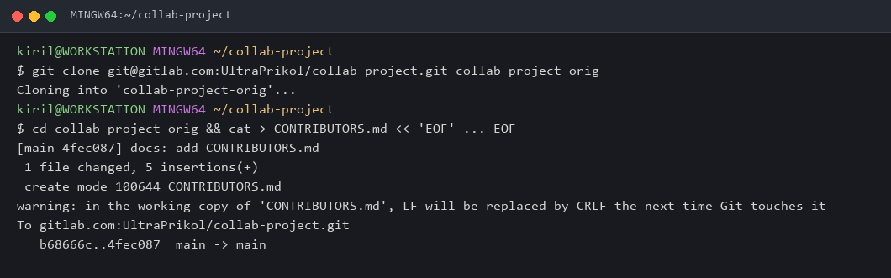
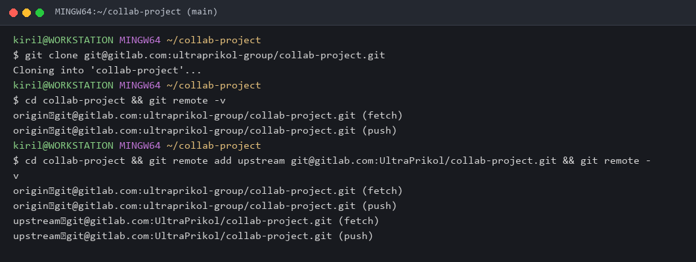
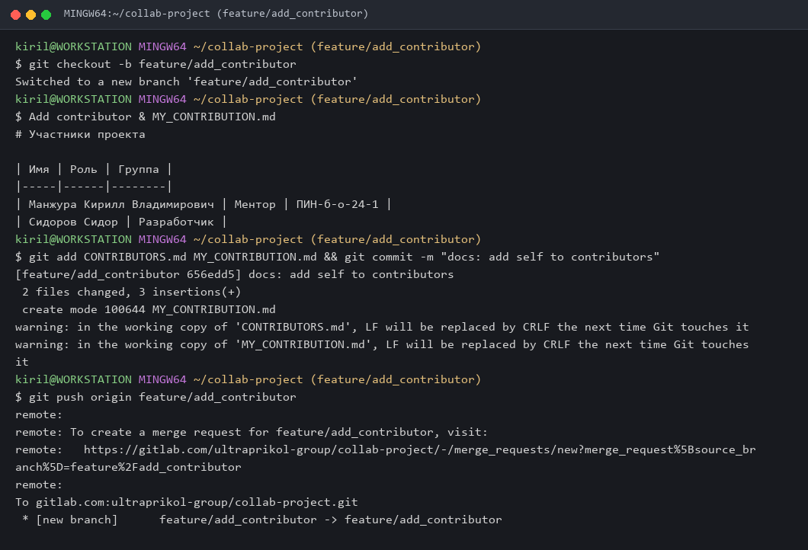
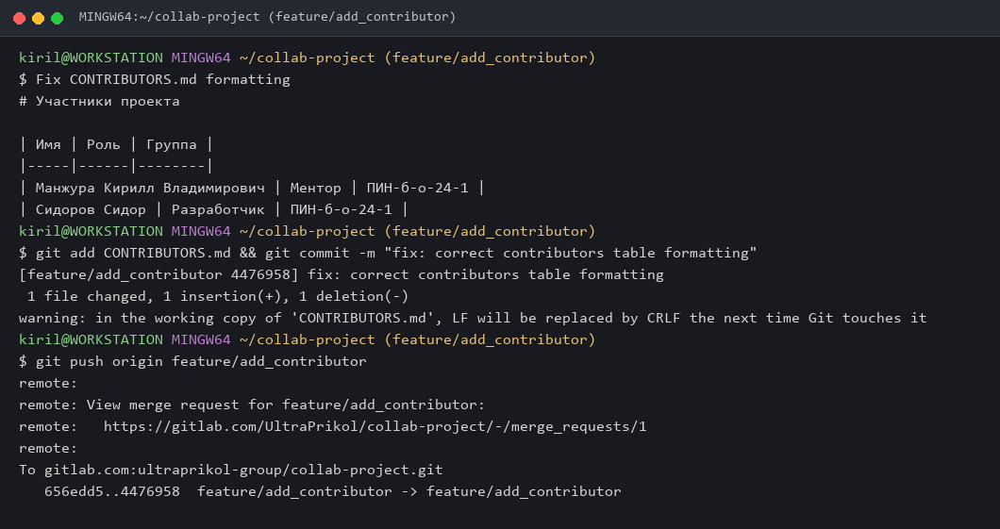
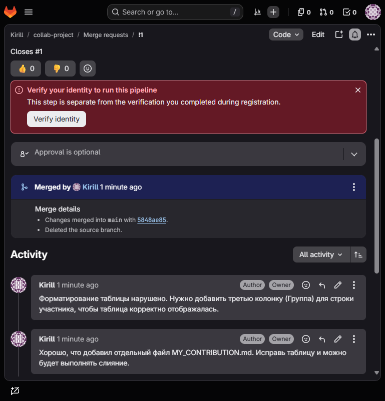
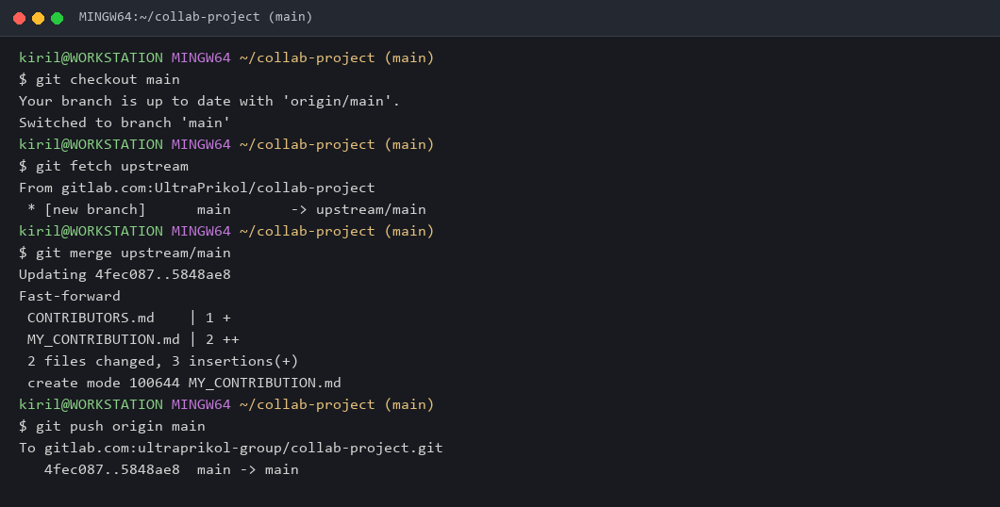
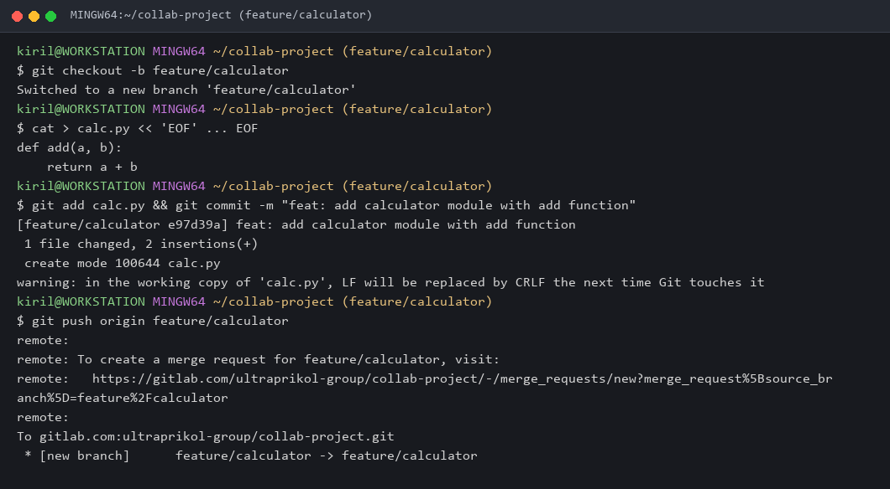
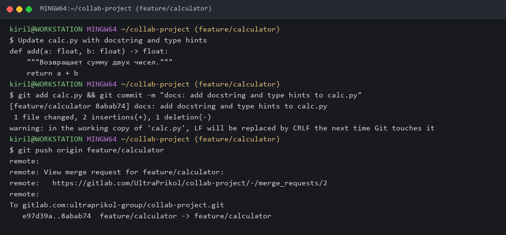
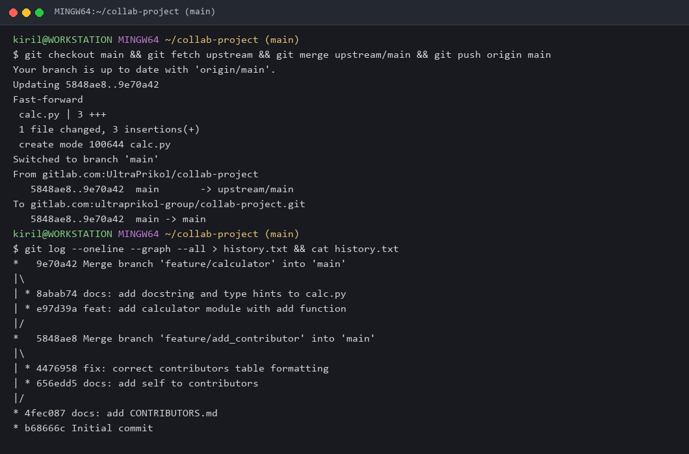

# Отчет по лабораторной работе 0302
# Лабораторная работа 3: Работа с удалёнными репозиториями. Совместная разработка в GitLab

**Дата:** 2026-09-18
**Семестр:** 5
**Группа:** ПИН-б-о-24-1
**Дисциплина:** Системы управления версий
**Студент:** Манжура Кирилл Владимирович

## 1. Цель работы

1. Освоить работу с удалёнными репозиториями в Git: `remote`, `fetch`, `pull`, `push`.
2. Изучить модель совместной разработки через **Fork** и **Merge Request** в GitLab.
3. Научиться работать с несколькими удалёнными репозиториями одновременно (`origin`, `upstream`).
4. Освоить процесс Code Review и внесения исправлений в открытый Merge Request.
5. Настроить защиту основной ветки (Protected Branches) в GitLab.

---

## 2. Требования к окружению

| Компонент | Версия / Источник |
|:---|:---|
| **Операционная система** | Windows 11 (Git Bash / MINGW64) |
| **Git** | `git version 2.53.0.windows.2` |
| **GitLab** | Аккаунт `@UltraPrikol` и группа `ultraprikol-group` на `gitlab.com` |

---

## 3. Теоретическое введение

### 3.1. Удалённые репозитории в Git
Локальный репозиторий может быть связан с несколькими удалёнными серверами. Обычно `origin` указывает на собственный форк разработчика, а `upstream` — на исходный (основной) репозиторий проекта.

### 3.2. Модель Fork + Merge Request
При коллективной разработке участник создаёт **Fork** исходного проекта, клонирует форк на рабочую машину, создаёт отдельную feature-ветку, отправляет изменения в свой форк (`origin`) и открывает **Merge Request (MR)** в целевую ветку `upstream`. После проведения **Code Review** и исправления замечаний MR сливается, а локальная ветка синхронизируется с `upstream/main`.

---

## 4. Ход выполнения работы

### Часть 1 — Fork, Clone и настройка `origin` и `upstream`

#### Шаг 1. Создание базового репозитория `collab-project`

На GitLab создан публичный проект `UltraPrikol/collab-project` с инициализированным `README.md`. Репозиторий склонирован локально, добавлен файл `CONTRIBUTORS.md` со строкой участника и отправлен в `main`:



#### Шаг 2–4. Создание Fork, клонирование и подключение `upstream`

Репозиторий `UltraPrikol/collab-project` форкнут в пространство имён `ultraprikol-group/collab-project`. Форк склонирован локально (`origin`), а исходный проект добавлен как `upstream`:

```bash
git clone git@gitlab.com:ultraprikol-group/collab-project.git
cd collab-project
git remote add upstream git@gitlab.com:UltraPrikol/collab-project.git
git remote -v
```



#### Шаг 5–6. Создание feature-ветки и отправка в форк

Создана ветка `feature/add_contributor`, в `CONTRIBUTORS.md` добавлен участник (с намеренной неполной строкой таблицы для последующего ревью), создан файл `MY_CONTRIBUTION.md` и ветка отправлена в `origin`:



---

### Часть 2 — Merge Request, Code Review, синхронизация и защита ветки

#### Шаг 7–10. Создание MR `!1`, Code Review, правки и слияние

Из форка `ultraprikol-group/collab-project:feature/add_contributor` открыт Merge Request `!1` в `UltraPrikol/collab-project:main`. В ходе Code Review оставлены замечания по форматированию таблицы в `CONTRIBUTORS.md`. Форматирование исправлено коммитом `fix: correct contributors table formatting` и отправлено в форк:



После одобрения MR `!1` слит в `main` (`Merged`), что видно в интерфейсе GitLab вместе с комментариями ревью:



#### Шаг 11. Синхронизация локального репозитория и форка с `upstream`

Выполнено переключение на `main`, загрузка изменений из `upstream`, слияние `upstream/main` и обновление `origin/main`:

```bash
git checkout main
git fetch upstream
git merge upstream/main
git push origin main
```



#### Шаг 12. Настройка Protected Branches

Для ветки `main` в `UltraPrikol/collab-project` настроена защита:
- **Allowed to merge:** `Maintainers` (`access_level: 40`)
- **Allowed to push:** `No one` (`access_level: 0`) — прямой push запрещён, изменения принимаются только через MR.

---

## 5. Выполнение комплексного задания для самостоятельной работы

Выполнены все 10 шагов комплексного задания:
1. От `main` создана ветка `feature/calculator`, добавлен файл `calc.py` с функцией `add(a, b)`, ветка отправлена в `origin`:



2. Открыт MR `!2`, оставлен комментарий ревью с требованием добавить `docstring` и аннотации типов, внесены правки (`8abab74`) и отправлены в форк:



3. MR `!2` слит в `main` (`9e70a42`), локальная копия и форк синхронизированы с `upstream`, история коммитов сохранена в `history.txt`:



---

## 6. Ответы на контрольные вопросы

1. **Что такое форк репозитория и зачем он нужен?**  
   Форк (Fork) — это независимая серверная копия чужого репозитория в вашем собственном аккаунте или группе на GitLab/GitHub. Он позволяет вносить любые изменения и создавать ветки без прав на прямую запись в исходный проект, а затем предлагать свои доработки через Merge Request.

2. **В чём разница между `git fetch` и `git pull`?**  
   `git fetch` только загружает новые объекты и ссылки из удалённого репозитория в локальные tracking-ветки (например, `upstream/main`), не затрагивая рабочую ветку. `git pull` выполняет `git fetch` и сразу сливает полученные изменения в текущую ветку.

3. **Зачем добавлять `upstream` при работе с форком?**  
   `origin` указывает на ваш личный форк, который со временем устаревает относительно оригинала. Подключение исходного репозитория под именем `upstream` позволяет регулярно получать свежие коммиты других участников (`git fetch upstream && git merge upstream/main`).

4. **Что такое Merge Request (Pull Request) и какова его роль в совместной разработке?**  
   Merge Request — это запрос на слияние одной ветки (или ветки из форка) в целевую ветку проекта. Он служит центральной точкой для обсуждения изменений, проведения Code Review, автоматического запуска CI/CD-проверок и контроля качества кода до его попадания в `main`.

5. **Какие этапы проходит MR от создания до слияния?**  
   Отправка ветки в репозиторий → создание MR (выбор source/target веток, описание) → прохождение CI/CD пайплайна → Code Review и обсуждение диффа → доработка кода новыми коммитами → одобрение (Approve) → слияние (Merge) и удаление временной ветки.

6. **Что такое Code Review и зачем он нужен?**  
   Code Review — это проверка кода одного разработчика другими участниками команды. Она позволяет выявлять логические ошибки, уязвимости, проблемы производительности и архитектуры на раннем этапе, поддерживать единый стиль кода и обмениваться знаниями внутри команды.

7. **Как обновить форк, если исходный репозиторий изменился?**  
   Переключиться на основную ветку (`git checkout main`), загрузить обновления из оригинала (`git fetch upstream`), слить их (`git merge upstream/main` или `rebase`) и отправить обновлённую ветку в свой форк (`git push origin main`).

8. **Что такое защищённые ветки (Protected Branches) и зачем они нужны?**  
   Protected Branches — механизм контроля доступа к важным веткам (`main`, `develop`), который запрещает прямой `push` и `force-push`, ограничивает круг лиц, имеющих право на слияние, и может требовать обязательного одобрения ревьюеров и успешного прохождения CI/CD.

9. **В чём разница между методами слияния: "Merge commit", "Squash commits", "Rebase and merge"?**  
   - **Merge commit** — сохраняет все коммиты ветки и добавляет отдельный коммит слияния.
   - **Squash commits** — объединяет все коммиты из MR в один аккуратный коммит перед слиянием.
   - **Rebase and merge** — перебазирует коммиты MR поверх целевой ветки для получения строго линейной истории.

10. **Как добавить нескольких участников в GitLab-проект?**  
    В настройках проекта **Manage → Members → Invite members** указываются имена пользователей или email-адреса и назначается роль доступа (`Guest`, `Reporter`, `Developer`, `Maintainer` или `Owner`).

---

## 7. Выводы

В ходе лабораторной работы №3 отработана полная модель совместной разработки в GitLab: создан исходный проект `collab-project` и его форк в `ultraprikol-group`, настроены два remote (`origin` и `upstream`), выполнены два цикла Merge Request с Code Review, правками, слиянием и последующей синхронизацией, а также настроена защита ветки `main`.
