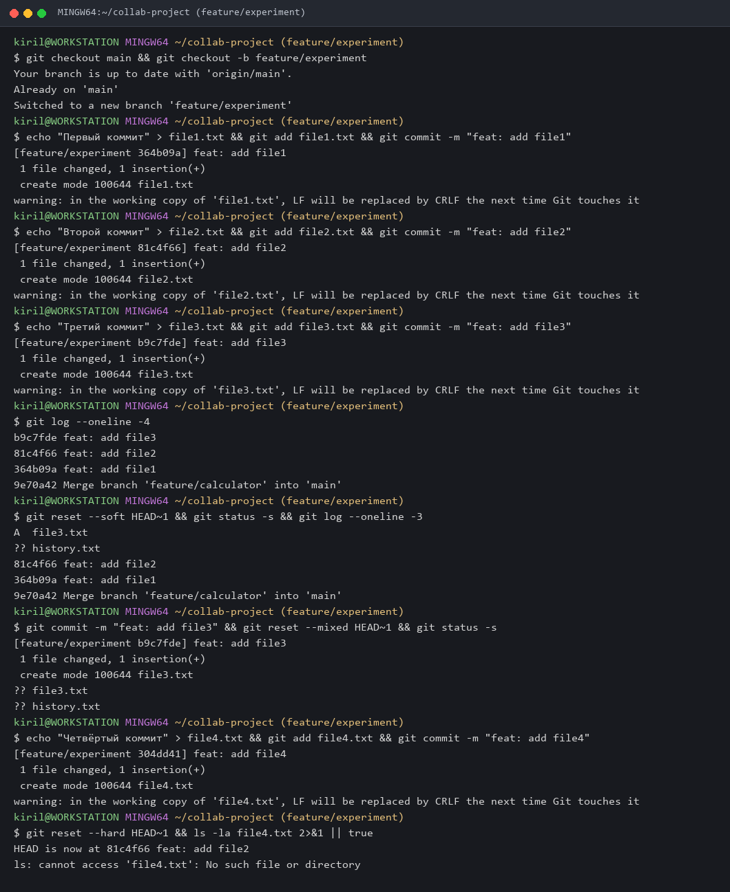
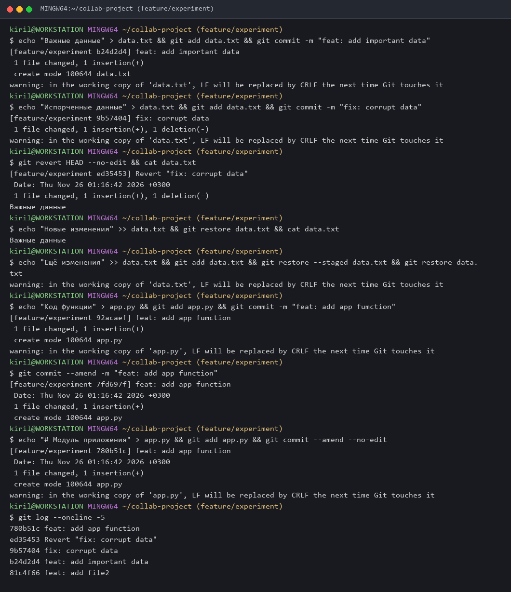
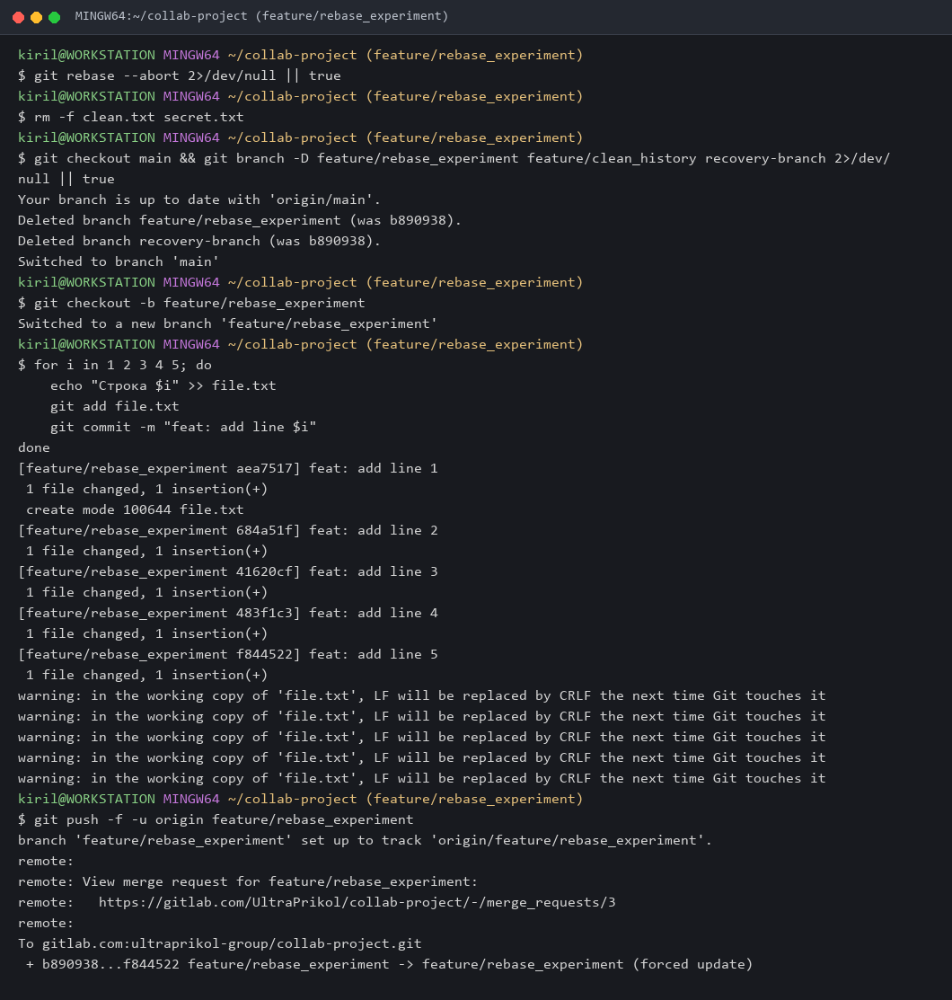
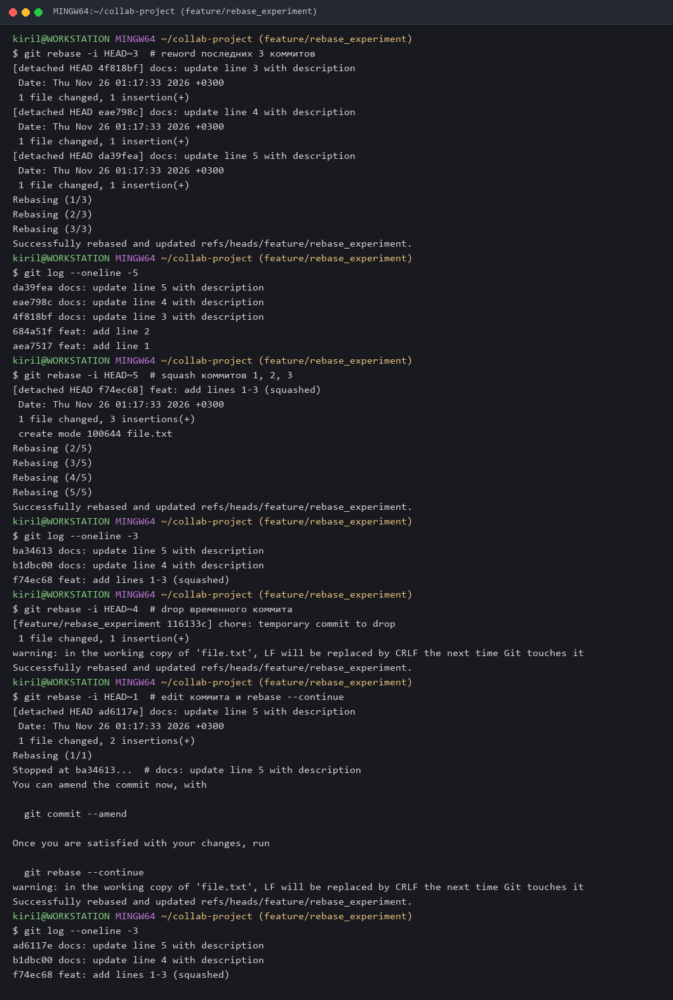
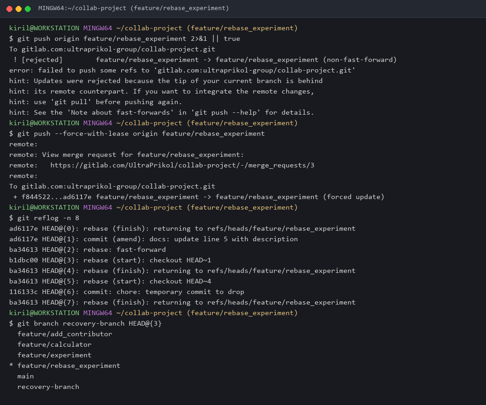
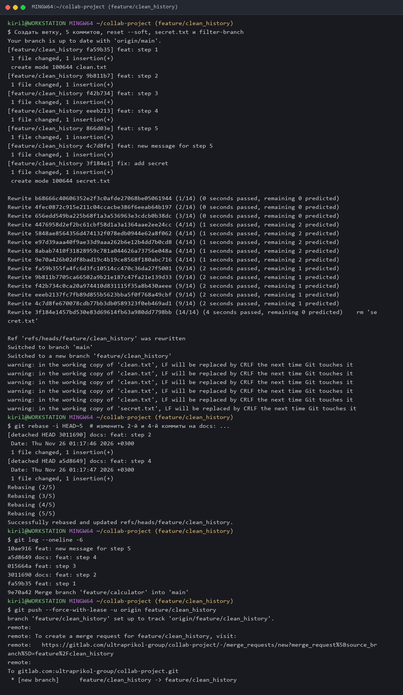
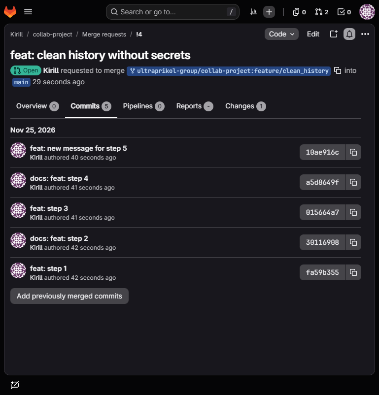

# Отчет по лабораторной работе 0402
# Лабораторная работа 4: Управление историей коммитов: rebase, reset, revert и интерактивный rebase

**Дата:** 2026-09-25
**Семестр:** 5
**Группа:** ПИН-б-о-24-1
**Дисциплина:** Системы управления версий
**Студент:** Манжура Кирилл Владимирович

## 1. Цель работы

1. Освоить различные способы отмены изменений в Git: `reset` (`--soft`, `--mixed`, `--hard`), `revert`, `restore`, `commit --amend`.
2. Научиться редактировать историю коммитов с помощью интерактивного rebase (`git rebase -i`: `reword`, `squash`, `drop`, `edit`).
3. Освоить операцию перебазирования и восстановление удалённых коммитов через `git reflog`.
4. Понять риски переписывания истории и научиться безопасно применять `git push --force-with-lease`.
5. Отработать удаление чувствительных данных (`secret.txt`) из истории репозитория с помощью `git filter-branch`.

---

## 2. Требования к окружению

| Компонент | Версия / Источник |
|:---|:---|
| **Операционная система** | Windows 11 (Git Bash / MINGW64) |
| **Git** | `git version 2.53.0.windows.2` |
| **GitLab** | Репозитории `ultraprikol-group/collab-project` и `UltraPrikol/collab-project` |

---

## 3. Теоретическое введение

### 3.1. Способы отмены изменений
- `git reset --soft <ref>` — отменяет коммит, оставляя изменения в индексе (staged).
- `git reset --mixed <ref>` — отменяет коммит и индексацию, сохраняя изменения в рабочей директории.
- `git reset --hard <ref>` — полностью удаляет коммиты и незафиксированные изменения в рабочей директории.
- `git revert <commit>` — создаёт новый коммит с обратными изменениями (не переписывает историю, безопасно для общих веток).
- `git restore` — отменяет изменения в рабочей директории или снимает файл с индексации (`--staged`).
- `git commit --amend` — изменяет последний коммит (сообщение и/или содержимое).

### 3.2. Интерактивный rebase (`git rebase -i`)
Позволяет переупорядочивать, переименовывать (`reword`), объединять (`squash`/`fixup`), удалять (`drop`) и редактировать (`edit`) коммиты перед отправкой на ревью. Золотое правило rebase: **не переписывать историю общих веток**.

---

## 4. Ход выполнения работы

### Часть 1 — Основы отмены изменений

#### Шаг 1–4. Практика с `git reset` (`--soft`, `--mixed`, `--hard`)

В репозитории `collab-project` создана экспериментальная ветка `feature/experiment` с тремя коммитами (`file1.txt`, `file2.txt`, `file3.txt`). Проверено поведение:
- `git reset --soft HEAD~1` — коммит удалён из ветки, `file3.txt` остался в индексе (`A`);
- `git reset --mixed HEAD~1` — `file3.txt` стал `untracked` (`??`);
- `git reset --hard HEAD~1` после создания `file4.txt` — файл `file4.txt` полностью удалён.

#### Шаг 5–7. Практика с `git revert`, `git restore` и `git commit --amend`

Продемонстрированы:
- отмена некорректного коммита (`fix: corrupt data`) командой `git revert HEAD --no-edit` с восстановлением содержимого `data.txt`;
- отмена изменений в рабочей директории (`git restore data.txt`) и снятие с индексации (`git restore --staged data.txt`);
- исправление опечатки в сообщении коммита (`git commit --amend -m "feat: add app function"`) и дозапись файла без изменения сообщения (`git commit --amend --no-edit`).

---

### Часть 2 — Интерактивный rebase и безопасный force push

#### Шаг 8–12. Серия из 5 коммитов и `git rebase -i` (`reword`, `squash`, `drop`, `edit`)

В ветке `feature/rebase_experiment` создана серия из 5 коммитов (`feat: add line 1` .. `feat: add line 5`) и отправлена в `origin`:

С помощью `git rebase -i` последовательно выполнены:
1. `reword` последних 3 коммитов (`docs: update line 3/4/5 with description`);
2. `squash` первых трёх коммитов в единый коммит `f74ec68` (`feat: add lines 1-3 (squashed)`);
3. `drop` добавленного временного коммита `chore: temporary commit to drop`;
4. `edit` коммита с добавлением строки, `git commit --amend --no-edit` и `git rebase --continue` (`ad6117e`).

#### Шаг 13–14 и раздел 7. Принудительный push (`--force-with-lease`) и `git reflog`

После переписывания истории обычный `git push` был отклонён (`rejected — non-fast-forward`), а `git push --force-with-lease origin feature/rebase_experiment` успешно обновил ветку и открыт MR `!3`. Также продемонстрирован просмотр `git reflog -n 8` и восстановление предыдущего состояния ветки через `git branch recovery-branch HEAD@{3}`:

---

## 5. Выполнение комплексного задания для самостоятельной работы

Выполнены все шаги комплексного задания в ветке `feature/clean_history`:
1. Созданы 5 коммитов (`clean.txt`), последний отменён через `git reset --soft HEAD~1` и перекоммичен с новым сообщением (`feat: new message for step 5`).
2. Добавлен файл `secret.txt` (`password=123`) и зафиксирован коммитом `fix: add secret`.
3. Файл `secret.txt` полностью вычищен из всей истории с помощью `git filter-branch --force --index-filter "git rm --cached --ignore-unmatch secret.txt" --prune-empty HEAD`.
4. Через `git rebase -i HEAD~5` изменены сообщения 2-го и 4-го коммитов на префикс `docs: ...`.
5. История отправлена через `git push --force-with-lease -u origin feature/clean_history` и создан MR `!4`.

На вкладке **Commits** в Merge Request `!4` на GitLab подтверждена чистая история из 5 коммитов без файла `secret.txt`:

---

## 6. Ответы на контрольные вопросы

1. **В чём разница между `git reset` и `git revert`? Когда что использовать?**  
   `git reset` перемещает указатель ветки назад и переписывает историю (применяется локально до отправки на сервер). `git revert` создаёт новый коммит, отменяющий действие целевого коммита, сохраняя всю историю (применяется для уже опубликованных и общих веток).

2. **Что делает `git reset --hard` и почему это опасно?**  
   `git reset --hard` откатывает указатель ветки, полностью сбрасывает индекс и перезаписывает рабочую директорию. Все незафиксированные изменения теряются безвозвратно, а коммиты удаляются из истории ветки (восстановить их можно только временно через `reflog`, если они были закоммичены).

3. **Какие действия можно выполнить с помощью интерактивного rebase?**  
   Переупорядочить коммиты, оставить без изменений (`pick`), изменить сообщение (`reword`), остановиться для доработки файлов (`edit`), объединить с предыдущим с редактированием сообщения (`squash`) или без (`fixup`), удалить коммит (`drop`) и выполнить shell-команду после шага (`exec`).

4. **Как объединить несколько коммитов в один с сохранением их сообщений?**  
   Запустить `git rebase -i HEAD~N`, оставить для первого коммита `pick`, а для последующих указать `squash` (или `s`) — Git предложит редактор со всеми сообщениями объединённых коммитов.

5. **Как изменить сообщение последнего коммита без создания нового?**  
   Командой `git commit --amend -m "новое сообщение"` (или `git commit --amend` с открытием редактора).

6. **Почему `git push --force` считается опасной операцией?**  
   Он безусловно перезаписывает удалённую ветку на сервере локальной историей и может уничтожить новые коммиты других разработчиков, которые были отправлены в эту ветку после вашего последнего `fetch`.

7. **Что такое `--force-with-lease` и чем он лучше обычного `--force`?**  
   Флаг `--force-with-lease` перед перезаписью проверяет, что удалённая ветка на сервере по-прежнему указывает на тот же коммит, который известен локально (`origin/<branch>`). Если кто-то успел запушить туда новые коммиты, команда отклонится, предотвратив потерю чужой работы.

8. **Как восстановить коммит, удалённый через `git reset --hard`?**  
   Найти хеш потерянного коммита в журнале перемещений `HEAD` командой `git reflog`, после чего создать от него ветку (`git branch recovery-branch <commit-hash>`) или вернуться к нему (`git reset --hard <commit-hash>`).

9. **В каких случаях используется `git revert`, а в каких — `git reset`?**  
   `git revert` — когда нужно отменить уже отправленные в общую ветку (`main`, `develop`) изменения. `git reset` — когда нужно локально переделать или откатить собственные ещё не опубликованные коммиты (или при работе с личной веткой с последующим `--force-with-lease`).

10. **Почему не рекомендуется использовать `rebase` на общих ветках?**  
    Потому что `rebase` меняет хеши коммитов и переписывает общую историю, вызывая рассинхронизацию у всех членов команды, которые уже базировали свои ветки на исходных коммитах.

---

## 7. Выводы

В ходе лабораторной работы №4 изучены и практически применены все основные команды управления историей Git: `reset` (`--soft`, `--mixed`, `--hard`), `revert`, `restore`, `--amend`, интерактивный `rebase -i` (`reword`, `squash`, `drop`, `edit`), `reflog`, `filter-branch` для удаления секретов из истории и безопасный `git push --force-with-lease`.
