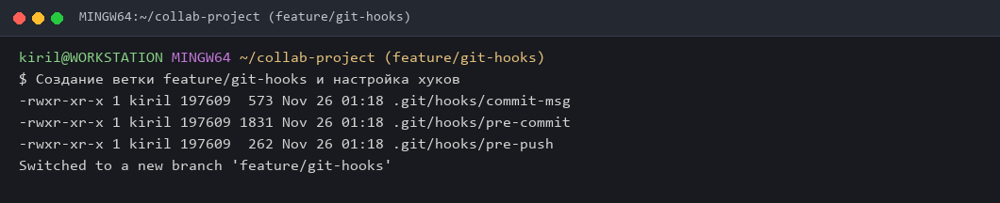
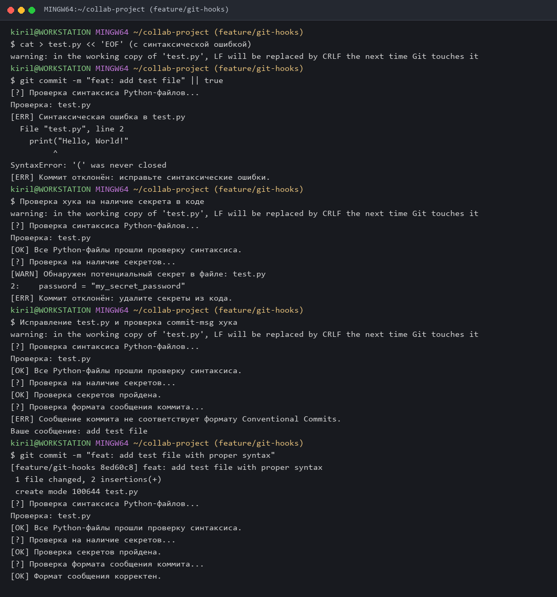
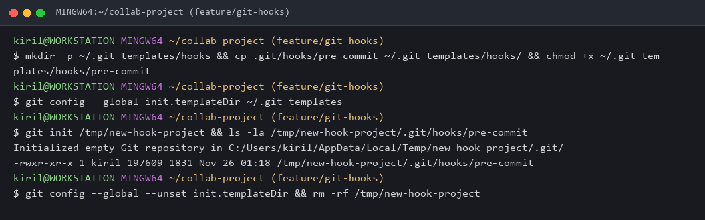
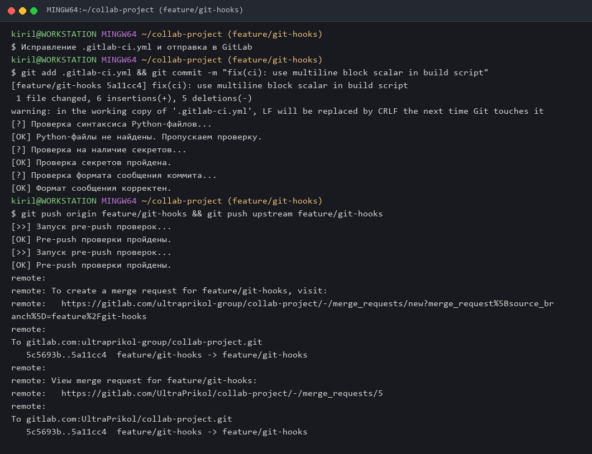
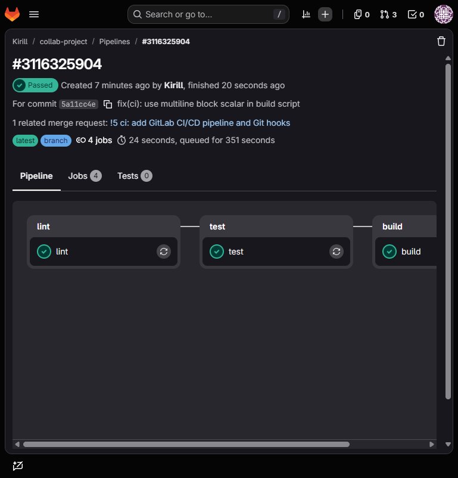

# Отчет по лабораторной работе 0502
# Лабораторная работа 5: Автоматизация разработки: Git Hooks и GitLab CI/CD

**Дата:** 2026-10-02
**Семестр:** 5
**Группа:** ПИН-б-о-24-1
**Дисциплина:** Системы управления версий
**Студент:** Манжура Кирилл Владимирович

## 1. Цель работы

1. Освоить механизм клиентских Git Hooks для автоматизации проверок до создания коммита и отправки изменений.
2. Настроить хуки `pre-commit` (проверка синтаксиса Python и поиск секретов), `commit-msg` (валидация Conventional Commits) и `pre-push`.
3. Реализовать скрипт массовой установки хуков (`.githooks/` + `scripts/install-hooks.sh`) и проверить глобальные шаблоны хуков (`init.templateDir`).
4. Познакомиться с GitLab CI/CD и создать базовый многостадийный пайплайн в `.gitlab-ci.yml`.
5. Настроить автоматическое выполнение пайплайна при создании Merge Request и интеграцию CI/CD с защитой ветки.

---

## 2. Требования к окружению

| Компонент | Версия / Источник |
|:---|:---|
| **Операционная система** | Windows 11 (Git Bash / MINGW64) |
| **Git** | `git version 2.53.0.windows.2` |
| **Python** | `Python 3.13.5` |
| **GitLab** | Репозиторий `UltraPrikol/collab-project` |
| **GitLab Runner** | Локальный проектный `gitlab-runner 19.6.1` (`shell / bash`) на базе ПК (`PRIKOLPC`) |

---

## 3. Теоретическое введение

### 3.1. Git Hooks
Git Hooks — пользовательские скрипты в `.git/hooks/`, запускаемые автоматически при наступлении определённых событий Git. Клиентские хуки (`pre-commit`, `commit-msg`, `post-commit`, `pre-push`) выполняются локально и позволяют отклонять коммит при ненулевом коде возврата (`exit 1`). Серверные проверки в GitLab реализуются через **GitLab CI/CD** и **Push Rules**.

### 3.2. GitLab CI/CD
Конфигурация пайплайна описывается в корневом файле `.gitlab-ci.yml`. Основные сущности: **Pipeline** (полный цикл), **Stage** (последовательная стадия), **Job** (конкретная задача внутри стадии), **Runner** (агент выполнения задач), **Artifacts** (выходные файлы джобы).

---

## 4. Ход выполнения работы

### Часть 1 — Настройка и тестирование Git Hooks

#### Шаг 1–5. Создание `pre-commit`, `commit-msg` и `pre-push`

В репозитории `collab-project` создана ветка `feature/git-hooks`. В `.git/hooks/` созданы исполняемые bash-скрипты:
- `pre-commit` — проверяет синтаксис индексированных `.py`-файлов через `python -m py_compile` и сканирует код регулярными выражениями на наличие захардкоженных паролей/ключей (`password=`, `secret=`, `token=`, `api_key=`);
- `commit-msg` — проверяет соответствие первой строки сообщения стандарту **Conventional Commits** (`^(feat|fix|docs|style|refactor|perf|test|chore|ci|build)(\([a-z0-9\-]+\))?: .{1,100}$`);
- `pre-push` — проверяет наличие файла `.gitlab-ci.yml`.

#### Шаг 6. Тестирование хуков

Проверены все три защитных сценария на файле `test.py`:
1. Попытка закоммитить код с синтаксической ошибкой (`SyntaxError: '(' was never closed`) — отклонена хуком `pre-commit`.
2. Попытка закоммитить строку `password = "my_secret_password"` — отклонена хуком `pre-commit` с предупреждением об утечке секрета.
3. Попытка коммита с сообщением `"add test file"` без типа Conventional Commits — отклонена хуком `commit-msg`.
4. Исправленный файл `test.py` с сообщением `"feat: add test file with proper syntax"` успешно зафиксирован коммитом `8ed60c8`.

#### Шаг 7. Совместное использование хуков и раздел 7 (Глобальные хуки)

Хуки скопированы в отслеживаемый каталог `.githooks/`, создан и выполнен скрипт `scripts/install-hooks.sh`. Также проверена настройка глобальных шаблонов хуков (`~/.git-templates/hooks` + `git config --global init.templateDir`): при инициализации тестового репозитория хук `pre-commit` автоматически скопировался в `.git/hooks/pre-commit`.

---

### Часть 2 — Настройка и запуск GitLab CI/CD

#### Шаг 8–13. Конфигурация `.gitlab-ci.yml`, MR `!5` и запуск пайплайна

Создан полный `test.py` (с `test_addition()` и `test_subtraction()`), `requirements.txt` и `.gitlab-ci.yml` со стадиями `lint` (`py_compile`), `test` (`python test.py`) и `build` (сборка каталога `dist/version.txt` в качестве артефакта со сроком хранения 30 дней).
В настройках проекта `UltraPrikol/collab-project` включено требование прохождения пайплайна перед слиянием (`only_allow_merge_if_pipeline_succeeds: True`), отключены shared runners (требующие внешней верификации аккаунта) и подключён проектный `gitlab-runner 19.6.1`.

При первой валидации GitLab CI Lint выявил ошибку YAML в строке `echo "App version: ..."` из-за двоеточия в неэкранированной строке; скрипт переведён в многострочный блок `|`, после чего конфигурация прошла CI Lint (`valid: True`) и отправлена коммитом `5a11cc4`:

Пайплайн `#3116325904` для Merge Request `!5` выполнился за 24 секунды со статусом **Passed** во всех трёх стадиях (`lint` → `test` → `build`):

---

## 5. Ответы на контрольные вопросы

1. **Что такое Git Hooks и какие типы хуков существуют?**  
   Git Hooks — это скрипты, автоматически вызываемые Git при наступлении событий жизненного цикла. Выделяют клиентские хуки (работают локально: `pre-commit`, `prepare-commit-msg`, `commit-msg`, `post-commit`, `pre-push`, `post-checkout`) и серверные хуки (работают на сервере при приёме push: `pre-receive`, `update`, `post-receive`).

2. **Как создать и установить Git Hook?**  
   В каталоге `.git/hooks/` создаётся файл с именем события (без расширения, например `pre-commit`), в первой строке указывается шебанг (`#!/bin/bash`), записывается логика проверки и задаётся право на выполнение (`chmod +x .git/hooks/pre-commit`). Для команды скрипты хранят в папке `.githooks/` внутри репозитория и устанавливают через скрипт или `git config core.hooksPath .githooks`.

3. **Для чего используется `pre-commit` хук?**  
   `pre-commit` запускается до создания коммита и проверяет содержимое индекса: синтаксис, форматирование (линтеры), отсутствие паролей/секретов, слишком больших файлов или быстрые unit-тесты. При коде возврата не 0 коммит отменяется.

4. **Как проверить формат сообщения коммита с помощью хука?**  
   В хуке `commit-msg` первый аргумент `$1` содержит путь ко временному файлу с текстом сообщения коммита. Скрипт считывает его и проверяет регулярным выражением (например, под формат Conventional Commits) через `grep -E`.

5. **Что такое GitLab CI/CD и какие задачи она решает?**  
   GitLab CI/CD — встроенная система непрерывной интеграции и доставки, автоматизирующая проверку стиля кода, запуск тестов, сборку пакетов/контейнеров, сканирование безопасности и развёртывание на тестовые и боевые серверы при каждом изменении в репозитории.

6. **Какие стадии пайплайна можно выделить в современном проекте?**  
   Типовая последовательность: `lint` (проверка стиля и статический анализ), `build` (компиляция и сборка артефактов/образов), `test` (unit-, интеграционные тесты и отчёт покрытия), `security` (SAST/сканирование зависимостей), `deploy` (развёртывание на staging и production).

7. **Как настроить выполнение пайплайна только при создании Merge Request?**  
   Использовать директиву `rules:` с условием `- if: $CI_PIPELINE_SOURCE == "merge_request_event"` (или устаревшее `only: [merge_requests]`).

8. **Что такое артефакты в GitLab CI/CD?**  
   Артефакты (`artifacts: paths: ...`) — это файлы и каталоги, созданные задачей (например, собранные бинарники `dist/`, отчёты `report.xml`, `coverage.xml`), которые GitLab сохраняет на сервере и передаёт последующим стадиям или предоставляет для скачивания в веб-интерфейсе.

9. **Как настроить защиту ветки с требованием успешного CI?**  
   В настройках проекта **Settings → Merge requests** включить опцию **Pipelines must succeed** (`only_allow_merge_if_pipeline_succeeds`), а в **Settings → Repository → Protected Branches** защитить `main` от прямого push.

10. **В чём разница между клиентскими и серверными Git Hooks?**  
    Клиентские хуки не синхронизируются автоматически при `git clone`, работают на машине разработчика и их можно обойти флагом `--no-verify`. Серверные хуки (и их аналог в GitLab — CI/CD и Push Rules) выполняются централизованно на сервере, обязательны для всех участников и не могут быть обойдены локально.

---

## 6. Выводы

В ходе лабораторной работы №5 реализованы и протестированы клиентские Git Hooks (`pre-commit`, `commit-msg`, `pre-push`), настроен скрипт установки `.githooks/` + `install-hooks.sh` и глобальный шаблон хуков. Настроен многостадийный пайплайн `.gitlab-ci.yml` (`lint`, `test`, `build`), подключён локальный GitLab Runner и получено успешное прохождение пайплайна `#3116325904` в Merge Request `!5`.
