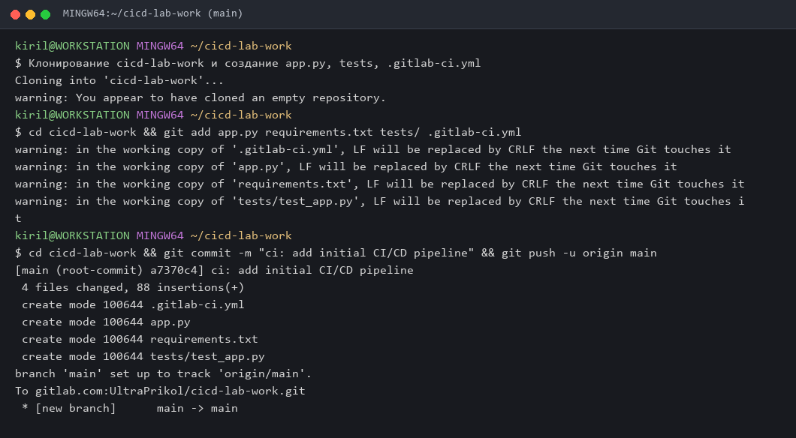
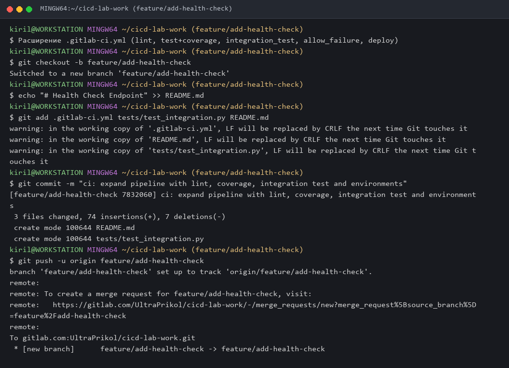
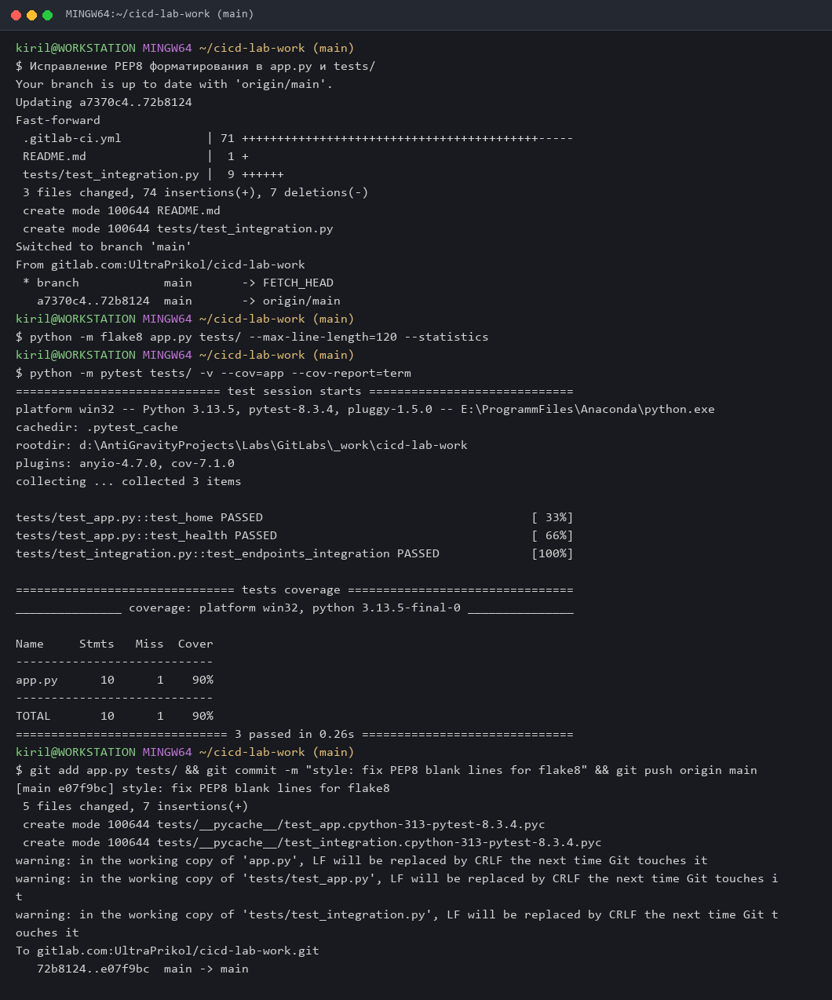
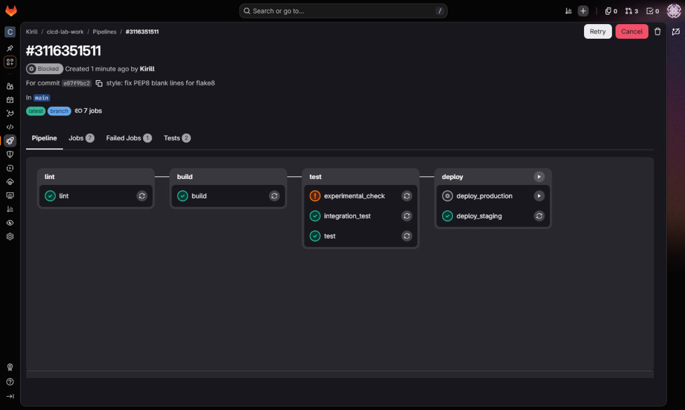

# Отчет по лабораторной работе 0602
# Лабораторная работа 6: GitLab CI/CD: Создание пайплайна для автоматизации сборки, тестирования и развертывания

**Дата:** 2026-10-16
**Семестр:** 5
**Группа:** ПИН-б-о-24-1
**Дисциплина:** Системы управления версий
**Студент:** Манжура Кирилл Владимирович

## 1. Цель работы

1. Изучить основные концепции GitLab CI/CD: пайплайны, стадии, джобы, раннеры, артефакты и кэширование.
2. Освоить синтаксис `.gitlab-ci.yml` и предотвращение бесконечных циклов через `workflow: rules`.
3. Создать многостадийный пайплайн для автоматизации линтинга (`flake8`), сборки, модульного/интеграционного тестирования (`pytest` + Cobertura coverage) и развёртывания.
4. Настроить правила выполнения джоб в зависимости от ветки и события (`merge_request_event`, `when: manual`, `allow_failure: true`).
5. Настроить окружения `staging`/`production` и расписание автоматического запуска пайплайнов (Pipeline Schedules).

---

## 2. Требования к окружению

| Компонент | Версия / Источник |
|:---|:---|
| **Операционная система** | Windows 11 (Git Bash / MINGW64) |
| **Git** | `git version 2.53.0.windows.2` |
| **Python / Инструменты** | `Python 3.13.5`, `Flask 3.0+`, `pytest 8.3.4`, `pytest-cov 7.1.0`, `flake8` |
| **GitLab** | Приватный репозиторий `UltraPrikol/cicd-lab-work` |
| **GitLab Runner** | Проектный `gitlab-runner 19.6.1` (`shell / bash`, `PRIKOLPC`) |

---

## 3. Теоретическое введение

### 3.1. Архитектура GitLab CI/CD
При каждом `git push` или создании Merge Request GitLab анализирует `.gitlab-ci.yml` в корне репозитория и запускает **Pipeline**. Пайплайн делится на последовательные **Stages** (`lint` → `build` → `test` → `deploy`), внутри которых **Jobs** выполняются параллельно доступными **Runners**. Передача результатов сборки между стадиями выполняется с помощью **Artifacts**, а оптимизация повторного скачивания зависимостей — через **Cache**.

### 3.2. Merge Request Pipelines и `workflow: rules`
Блок `workflow: rules` управляет созданием пайплайна целиком (например, запрещая запуск при создании тега `- if: $CI_COMMIT_TAG` / `when: never`). На уровне конкретных джоб `rules` позволяют отделить проверки MR (`$CI_PIPELINE_SOURCE == 'merge_request_event'`) от джоб деплоя, которые должны выполняться только на ветке по умолчанию `$CI_DEFAULT_BRANCH`.

---

## 4. Ход выполнения работы

### Часть 1 — Создание приложения и базового пайплайна

#### Шаг 1–6. Проект `cicd-lab-work`, Flask-приложение, тесты и первый пайплайн

На GitLab создан приватный проект `UltraPrikol/cicd-lab-work` (подключён проектный раннер). Создано Flask-приложение `app.py` с маршрутами `/` и `/health`, `requirements.txt`, модульные тесты `tests/test_app.py` (`test_home`, `test_health`) и базовый `.gitlab-ci.yml` (`build`, `test` с отчётом `report.xml`, ручной `deploy_staging`). После коммита `a7370c4` и `git push -u origin main`:

Пайплайн `#3116347873` успешно прошёл стадии `build` и `test`, оставив `deploy_staging` в состоянии `manual`.

---

### Часть 2 и раздел 5 — Расширение пайплайна, MR, интеграционные тесты, покрытие и расписание

#### Шаг 7–10 и комплексное задание. Расширенный `.gitlab-ci.yml` и проверка линтингом

В пайплайн и проект добавлены:
- `workflow: rules` для игнорирования `$CI_COMMIT_TAG`;
- стадия `lint` (`python -m flake8 app.py tests/ --max-line-length=120 --statistics`);
- артефакты сборки `dist/` в джобе `build`;
- отчёт покрытия **Cobertura** (`coverage.xml`) и **JUnit** (`report.xml`) в `test`;
- джоба `integration_test` (`tests/test_integration.py` с зависимостью `dependencies: [build]`);
- экспериментальная джоба `experimental_check` с `allow_failure: true`;
- автоматический `deploy_staging` (запускает `app.py`, проверяет `curl -sf http://localhost:5000/health` и корректно останавливает процесс) и ручной `deploy_production` (`when: manual`);
- расписание запуска **Pipeline Schedule** (`Nightly CI build & test`, cron `0 3 * * *`, `Europe/Moscow`).

Изменения отправлены в ветку `feature/add-health-check` и открыт MR `!1`:

При запуске пайплайна `#3116349109` джоба `lint` выявила нарушения PEP8 (`E302`/`E305` — нехватка двух пустых строк перед функциями в `app.py` и тестах). Форматирование исправлено коммитом `e07f9bc` (`style: fix PEP8 blank lines for flake8`), локально подтверждено отсутствие ошибок `flake8` и 90% покрытие кода `app.py` (3/3 теста прошли за 0.30 с):

Итоговый пайплайн `#3116351511` на ветке `main` прошёл все 4 стадии: `lint` (Passed), `build` (Passed), `test` + `integration_test` (Passed), `experimental_check` (Failed with `allow_failure`, не заблокировала пайплайн), `deploy_staging` (Passed — реальный healthcheck `localhost:5000/health`), а `deploy_production` ожидает ручного запуска (`Manual`):

---

## 5. Ответы на контрольные вопросы

1. **Что такое GitLab Runner и какие типы раннеров существуют?**  
   GitLab Runner — это агент-исполнитель, получающий задания от сервера GitLab и выполняющий их скрипты. По области видимости различают **Instance (Shared) runners** (общие для всех проектов инстанса), **Group runners** (для группы) и **Project (Specific) runners** (для конкретных проектов). По исполнителю (executor) — `shell`, `docker`, `kubernetes`, `ssh`, `virtualbox` и др.

2. **В чём разница между `stages` и `jobs` в GitLab CI/CD?**  
   `stages` задают упорядоченные этапы выполнения пайплайна, которые выполняются строго последовательно. `jobs` — конкретные задачи, привязанные к определённой стадии через `stage:`; все джобы одной стадии запускаются параллельно (при наличии раннеров).

3. **Как настроить кэширование зависимостей в пайплайне?**  
   С помощью директивы `cache:` (глобально или на уровне джобы), указав список путей (`paths: [.cache/pip, node_modules/]`) и при необходимости ключ кэша (`key: $CI_COMMIT_REF_SLUG` или `key: files: [requirements.txt]`).

4. **Что такое артефакты и как они используются между джобами?**  
   Артефакты (`artifacts: paths: ...`) — выходные файлы джобы (сборка, отчёты, бинарники), загружаемые на сервер GitLab. Последующие стадии автоматически скачивают артефакты предыдущих стадий (или выборочно через `dependencies: [job_name]` / `needs:`).

5. **В чём отличие Merge Request пайплайнов от обычных Branch пайплайнов?**  
   Branch-пайплайн запускается при каждом `git push` в ветку и видит состояние только этой ветки. Merge Request пайплайн (`$CI_PIPELINE_SOURCE == "merge_request_event"`) привязан к MR, имеет доступ к предопределённым переменным MR (`CI_MERGE_REQUEST_TARGET_BRANCH_NAME`, `CI_MERGE_REQUEST_IID`) и позволяет запускать отдельные проверки именно для ревью перед слиянием.

6. **Как настроить ручной запуск джобы с помощью `when: manual`?**  
   Добавить в описание джобы параметр `when: manual` (или внутри правила `rules: - if: ... / when: manual`). Пайплайн остановится перед этой задачей (статус `Blocked`/`Manual`), и её нужно будет запустить кнопкой в GitLab UI или через API.

7. **Что такое `workflow: rules` и как его использовать для предотвращения бесконечных циклов?**  
   `workflow: rules` определяет глобальное условие, должен ли вообще создаваться пайплайн для данного события. Чтобы создание тега внутри джобы не вызывало повторный запуск пайплайна по кругу, добавляют правило `- if: $CI_COMMIT_TAG` с `when: never`.

8. **Как настроить переменные окружения в GitLab CI/CD?**  
   Либо непосредственно в `.gitlab-ci.yml` в блоке `variables:` (для несекретных настроек), либо через веб-интерфейс **Settings → CI/CD → Variables** (с возможностью пометки `Protected`, `Masked` и ограничения области окружения `Environment scope`).

9. **Что такое `allow_failure` и когда его используют?**  
   Параметр `allow_failure: true` разрешает джобе завершиться ошибкой, не переводя весь пайплайн в статус `Failed` (в UI отображается оранжевое предупреждение). Используется для экспериментальных проверок, необязательного сканирования безопасности или нестабильных тестов.

10. **Как настроить автоматический запуск пайплайна по расписанию?**  
    В разделе **Build → Pipeline schedules** (или **Settings → CI/CD → Schedules**) создать новое расписание (**New schedule**), задать описание, cron-выражение (например, `0 3 * * *`), часовой пояс и целевую ветку (`main`).

---

## 6. Выводы

В ходе лабораторной работы №6 создан проект `cicd-lab-work` с приложением на Flask, модульными и интеграционными тестами `pytest`, проверкой покрытия Cobertura, линтером `flake8`, артефактами, экспериментальной задачей `allow_failure: true`, расписанием пайплайнов и развёртыванием на `staging` и `production`. Пайплайн `#3116351511` успешно выполнен на проектном раннере в GitLab.
