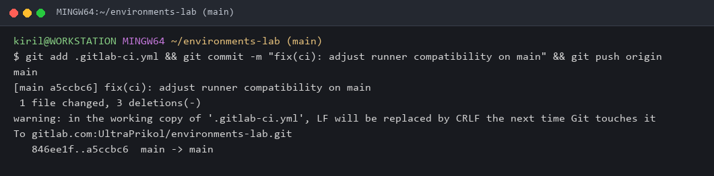
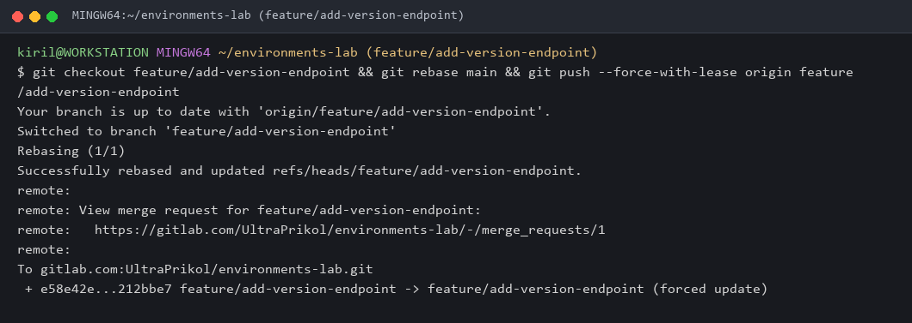
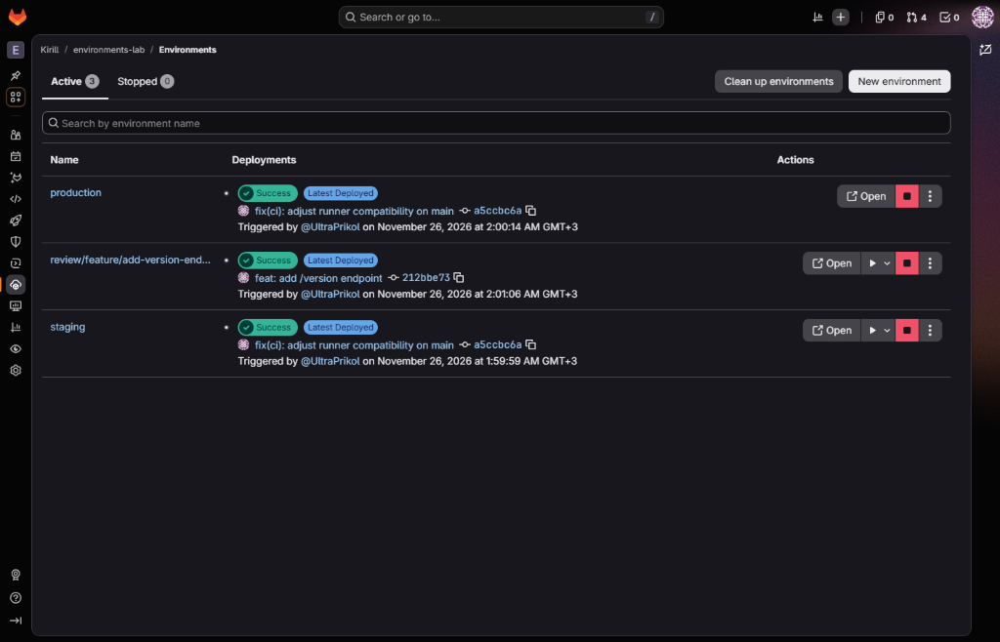

# Отчет по лабораторной работе 0702
# Лабораторная работа 7: Окружения, Review Apps и управление развертыванием в GitLab

**Дата:** 2026-10-30
**Семестр:** 5
**Группа:** ПИН-б-о-24-1
**Дисциплина:** Системы управления версий
**Студент:** Манжура Кирилл Владимирович

## 1. Цель работы

1. Изучить концепцию статических, динамических и защищённых окружений (Environments) в GitLab CI/CD.
2. Настроить статические окружения `staging` (автоматический деплой) и `production` (ручной деплой).
3. Освоить создание динамических окружений и **Review Apps** для изолированного тестирования Merge Request.
4. Настроить механизм остановки Review App (`on_stop` и `action: stop`).
5. Настроить переменные окружения с разграничением области видимости (`environment_scope`) и защиту окружения `production`.

---

## 2. Требования к окружению

| Компонент | Версия / Источник |
|:---|:---|
| **Операционная система** | Windows 11 (Git Bash / MINGW64) |
| **Git** | `git version 2.53.0.windows.2` |
| **Стек приложения** | Альтернативный стек из методички: `Python 3.13.5`, `Flask`, `pytest` (вместо Node.js) + `Dockerfile` |
| **GitLab** | Приватный репозиторий `UltraPrikol/environments-lab` |
| **GitLab Runner** | Проектный `gitlab-runner 19.6.1` (`shell / bash`) |

---

## 3. Теоретическое введение

### 3.1. Окружения (Environments) и стратегии развертывания
**Environment** в GitLab представляет собой целевую среду развёртывания (`staging`, `production`, `review/...`). GitLab фиксирует каждый деплой в истории окружения, отображает внешний URL и позволяет выполнять откат (**Rollback**) к предыдущей версии.
В модели **Continuous Delivery** деплой на тестовую среду (`staging`) происходит автоматически, а выпуск на боевую (`production`) подтверждается вручную (`when: manual`).

### 3.2. Review Apps
**Review Apps** — временные динамические окружения вида `review/$CI_COMMIT_REF_NAME` с уникальным URL на базе `$CI_ENVIRONMENT_SLUG`, автоматически разворачиваемые для каждого Merge Request. При удалении ветки или слиянии MR окружение останавливается связанной задачей `on_stop` (`action: stop`).

---

## 4. Ход выполнения работы

### Часть 1 — Приложение, статические окружения и переменные с областью видимости

#### Шаг 1–6 и 11. Создание `environments-lab`, настройка переменных и статических окружений

На GitLab создан проект `UltraPrikol/environments-lab`. Через настройки CI/CD добавлены переменные с областью видимости (`environment_scope`):
- `APP_VERSION` = `1.0.0` (scope: `*`);
- `STAGING_URL` = `https://staging.example.com` (scope: `staging`);
- `PRODUCTION_URL` = `https://production.example.com` (scope: `production`);
- `PROD_API_KEY` (scope: `production`, `masked: true`).

Реализовано веб-приложение на Flask (`app.py` с маршрутами `/` и `/health`), тесты `test_app.py`, `Dockerfile` и `.gitlab-ci.yml` со стадиями `test`, `build` (с генерацией `dist/release-notes.txt` из `git log`), `deploy` (`deploy_staging` и ручной `deploy_production`) и `cleanup`:

Пайплайн `#3116361939` на `main` выполнил `test`, `build_package` и `deploy_staging` (успех), после чего ручной запуск джобы `deploy_production` завершился со статусом `success`.

---

### Часть 2 — Защищённое окружение, Review Apps и динамические окружения

#### Шаг 7–10. Защита `production` и тестирование Review App в Merge Request

Для окружения `production` создана защита **Protected Environment** (`deploy_access_levels: Maintainers`).
Затем создана ветка `feature/add-version-endpoint`, добавлен эндпоинт `/version` в `app.py` и открыт Merge Request `!1` в `main`:

Пайплайн Merge Request `#3116365771` успешно выполнил `test`, `build_package` и `deploy_review`, создав динамическое окружение `review/feature/add-version-endpoint` с URL `https://review-feature-ad-ypvl1x.example.com/` и привязанной ручной задачей остановки `stop_review_app` (`on_stop`).

В разделе GitLab **Deployments → Environments** подтверждены все три активных окружения (`Active 3`) со статусом **Success**:
- `production` (коммит `a5ccbc6a`, `https://production.example.com/`);
- `staging` (коммит `a5ccbc6a`, `https://staging.example.com/`);
- `review/feature/add-version-endpoint` (коммит `212bbe73`, `https://review-feature-ad-ypvl1x.example.com/`).

---

## 5. Ответы на контрольные вопросы

1. **Что такое окружение (Environment) в GitLab CI/CD и какие типы окружений существуют?**  
   Окружение — это логическая метка в GitLab, описывающая среду развёртывания кода и отслеживающая историю всех деплоев. Типы: **Static** (постоянные: `staging`, `production`), **Dynamic** (создаются по имени ветки/переменным), **Review Apps** (динамические окружения для каждого MR) и **Protected** (с ограниченным доступом на деплой).

2. **Что такое Review Apps и какие задачи они решают в процессе разработки?**  
   Review Apps — временные изолированные стенды, разворачиваемые автоматически для каждой feature-ветки или MR. Они позволяют разработчикам, тестировщикам и заказчикам проверять изменения по живой ссылке прямо из интерфейса MR до слияния в `main`.

3. **Как настроить автоматическое создание Review App при создании Merge Request?**  
   В джобе развёртывания указать блок `environment:` с динамическим именем `name: review/$CI_COMMIT_REF_NAME`, URL `https://$CI_ENVIRONMENT_SLUG.example.com` и правилом запуска `rules: - if: $CI_PIPELINE_SOURCE == "merge_request_event"`.

4. **Как настроить ручной деплой в production с помощью `when: manual`?**  
   В джобе `deploy_production` с `environment: name: production` добавить `when: manual` (в сочетании с `if: $CI_COMMIT_BRANCH == $CI_DEFAULT_BRANCH`), чтобы деплой требовал явного подтверждения кнопкой в UI.

5. **Как обеспечить, чтобы в production могли деплоить только определённые пользователи?**  
   Настроить **Protected Environment** в **Settings → CI/CD → Protected Environments**, выбрав `production` и задав список разрешённых ролей (`Maintainers`) или конкретных пользователей в **Allowed to deploy**.

6. **Как остановить Review App после слияния MR?**  
   В блоке `environment:` джобы `deploy_review` указать `on_stop: stop_review_app`, а в джобе `stop_review_app` задать то же имя окружения, `action: stop` и `when: manual`. GitLab автоматически запустит `stop_review_app` при закрытии или слиянии MR и удалит временный стенд.

7. **Что такое динамические окружения и как они создаются в GitLab?**  
   Динамические окружения — это окружения, имя и URL которых формируются во время выполнения пайплайна с помощью предопределённых переменных GitLab (`$CI_COMMIT_REF_NAME`, `$CI_ENVIRONMENT_SLUG`, `$CI_MERGE_REQUEST_IID`).

8. **Как настроить переменные окружения, доступные только для конкретного окружения?**  
   В **Settings → CI/CD → Variables** при добавлении переменной указать нужную область в поле **Environments** (например, `staging` или `production` вместо `All (*)`).

9. **Как просмотреть историю деплоев и выполнить откат через интерфейс GitLab?**  
   В разделе **Operate / Deployments → Environments** выбрать нужное окружение — откроется список всех выполненных развёртываний с коммитами и временем. Для отката достаточно нажать кнопку **Rollback** напротив более раннего успешного деплоя.

10. **В чём разница между Continuous Deployment и Continuous Delivery?**  
    **Continuous Delivery** (непрерывная доставка) гарантирует, что код всегда готов к выпуску, автоматически тестируется и разворачивается на `staging`, но решение о выкладке в `production` принимается вручную. **Continuous Deployment** (непрерывное развёртывание) автоматически выкладывает каждый успешно прошедший все проверки коммит прямо в `production` без ручного подтверждения.

---

## 6. Выводы

В ходе лабораторной работы №7 в проекте `environments-lab` настроены статические окружения `staging` (автодеплой) и `production` (ручной деплой + Protected Environment), заданы переменные с разграничением по `environment_scope`, а также реализованы динамические **Review Apps** с механизмом остановки `on_stop` для Merge Request `!1`.
