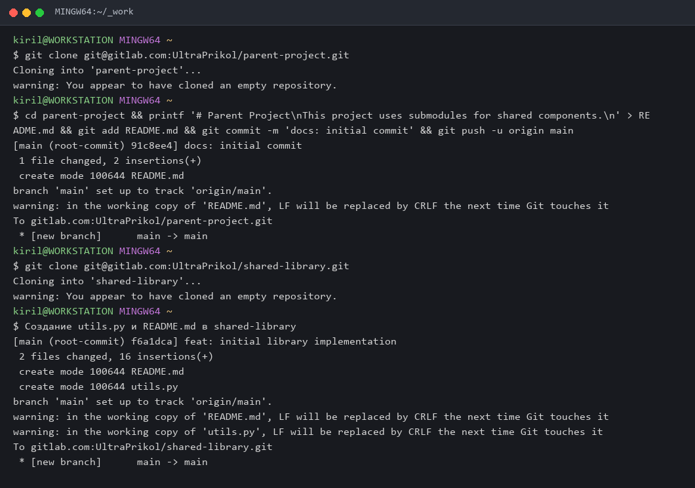
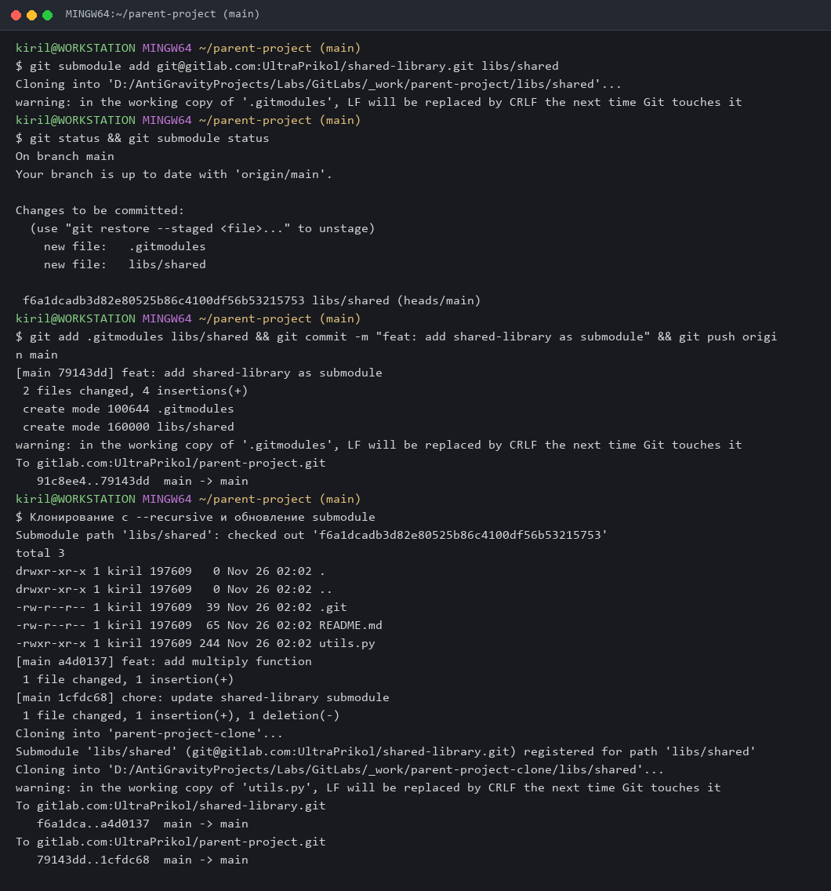
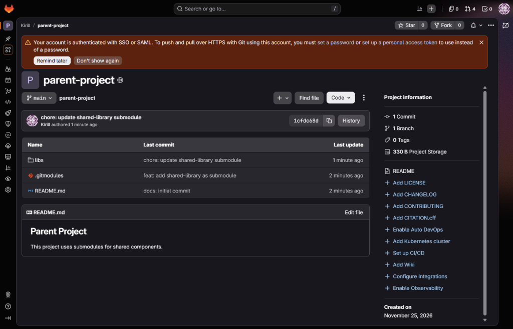
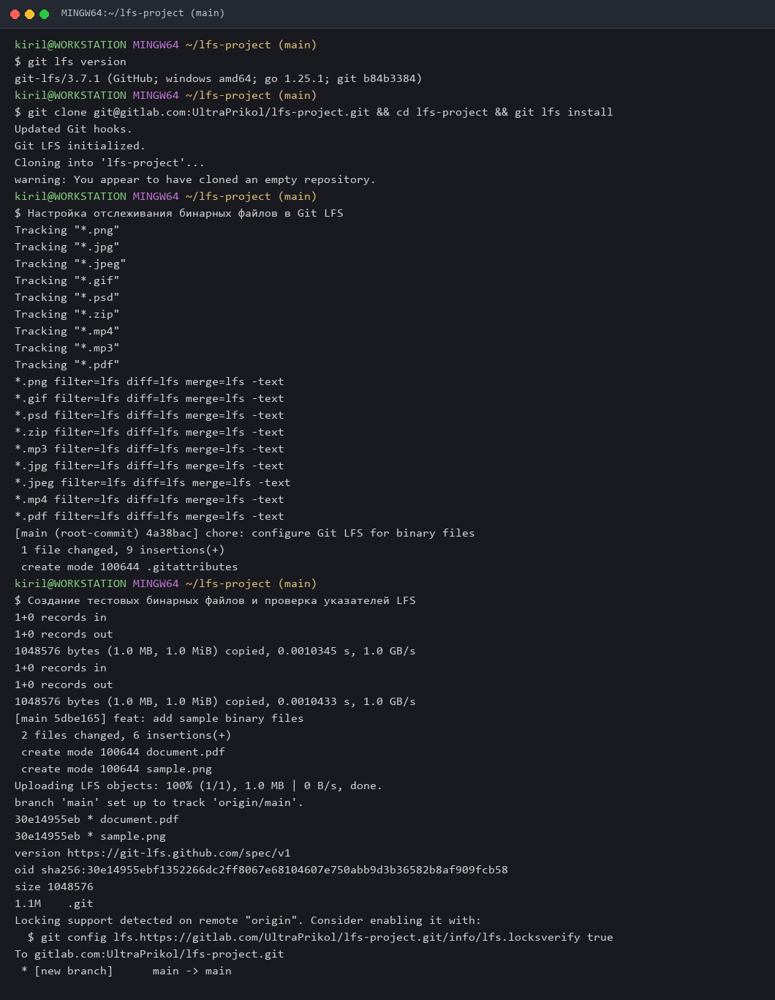
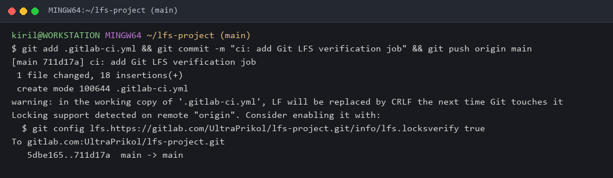
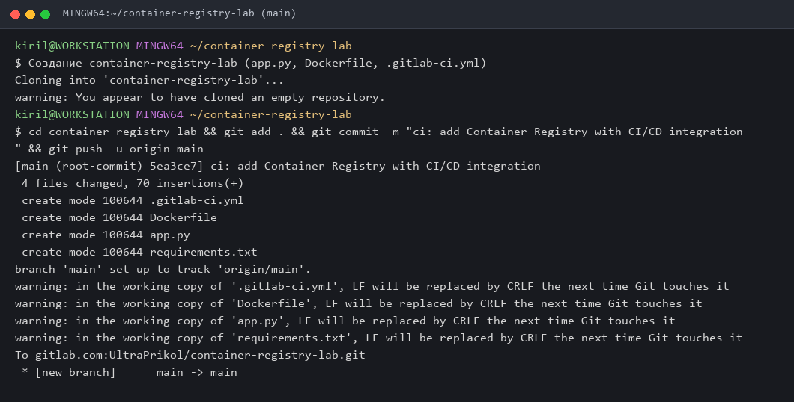

# Отчет по лабораторной работе 0802
# Лабораторная работа 8: Git Submodules, Git LFS и Container Registry в GitLab

**Дата:** 2026-11-06
**Семестр:** 5
**Группа:** ПИН-б-о-24-1
**Дисциплина:** Системы управления версий
**Студент:** Манжура Кирилл Владимирович

## 1. Цель работы

1. Освоить работу с **Git Submodules** для подключения и обновления внешних зависимостей между репозиториями.
2. Изучить **Git LFS (Large File Storage)** для эффективного хранения бинарных файлов через файлы-указатели и проверить работу LFS в GitLab CI/CD.
3. Подготовить конфигурацию **GitLab Container Registry** (`Dockerfile` и `.gitlab-ci.yml`) для сборки, тестирования и публикации Docker-образов и провалидировать её в GitLab CI Lint.
4. Сравнить подходы Git Submodules и Git Subtree.

---

## 2. Требования к окружению

| Компонент | Версия / Источник |
|:---|:---|
| **Операционная система** | Windows 11 (Git Bash / MINGW64) |
| **Git** | `git version 2.53.0.windows.2` |
| **Git LFS** | `git-lfs/3.7.1 (GitHub; windows amd64; go 1.25.1)` |
| **Docker** | CLI `29.6.1` (локальный демон `Docker Desktop Service` остановлен без прав администратора) |
| **GitLab** | Репозитории `parent-project`, `shared-library`, `lfs-project`, `container-registry-lab` |

---

## 3. Теоретическое введение

### 3.1. Git Submodules
**Git Submodules** позволяют вложить один Git-репозиторий в подкаталог другого. В родительском репозитории хранятся файл `.gitmodules` с URL/путём подмодуля и специальный gitlink-указатель на конкретный хеш коммита зависимости.

### 3.2. Git LFS (Large File Storage)
**Git LFS** заменяет крупные бинарные файлы (`.png`, `.pdf`, `.mp4`, `.psd`, `.zip` и т.д.) в истории Git лёгкими текстовыми файлами-указателями (pointer files), а сами бинарные объекты загружаются на отдельный LFS-сервер GitLab, сохраняя быстрое клонирование и малый размер `.git`.

### 3.3. GitLab Container Registry
Встроенный реестр Docker-образов для каждого GitLab-проекта (`$CI_REGISTRY_IMAGE`), интегрированный с переменными CI/CD (`$CI_REGISTRY_USER`, `$CI_REGISTRY_PASSWORD`) для автоматической сборки и публикации тегированных контейнеров.

---

## 4. Ход выполнения работы

### Часть 1 — Git Submodules

#### Шаг 1–6. Создание `parent-project` и `shared-library`, добавление, клонирование `--recursive` и обновление

На GitLab созданы публичные репозитории `UltraPrikol/parent-project` и `UltraPrikol/shared-library`. В `shared-library` добавлена библиотека `utils.py` (`greet`, `add`, `get_version`), коммит `f6a1dca`:

Библиотека подключена как подмодуль в `libs/shared` (`git submodule add`), зафиксированы `.gitmodules` и ссылка (`79143dd`), проверено рекурсивное клонирование (`git clone --recursive`), затем внутри подмодуля добавлена функция `multiply(a, b)` и обновлена ссылка в родительском проекте (`1cfdc68`):

В веб-интерфейсе GitLab в корне `parent-project` отображаются `.gitmodules` и каталог `libs/`, содержащий ссылку на коммит подмодуля `shared-library`:

---

### Часть 2 — Git LFS в GitLab

#### Шаг 7–12. Настройка `git lfs track`, бинарные файлы, проверка указателей и CI/CD

Проверена версия `git-lfs/3.7.1`, создан приватный проект `UltraPrikol/lfs-project` с включённым LFS и привязанным раннером. Настроено отслеживание шаблонов (`*.png`, `*.jpg`, `*.pdf`, `*.mp4`, `*.mp3`, `*.zip` и др.) в `.gitattributes` (`4a38bac`).
Созданы бинарные файлы `sample.png` и `document.pdf` (по 1 МиБ), закоммичены (`5dbe165`) и отправлены в GitLab (включая загрузку LFS-объектов `Uploading LFS objects: 100% (2/2)`). Команда `git show HEAD:sample.png` подтвердила, что в самом объекте Git хранится лишь 128-байтный текстовый указатель `oid sha256:...` (`size 1048576`):

Добавлен `.gitlab-ci.yml` с задачей `test_lfs` (выполняет `git lfs pull`, `git lfs ls-files`, проверяет размер восстановленных файлов). После push (`711d17a`) пайплайн `#3116372196` на GitLab завершился со статусом **success**:

---

### Часть 3 — GitLab Container Registry

#### Шаг 13–15. Создание `container-registry-lab` с `Dockerfile` и `.gitlab-ci.yml`

Создан проект `UltraPrikol/container-registry-lab`, подготовлены Flask-приложение `app.py`, `requirements.txt`, `Dockerfile` (на базе `python:3.11-slim`) и полный `.gitlab-ci.yml` со стадиями `build_image` и `publish_image` (через `docker:dind`, `docker login`, `docker build`, `docker push $CI_REGISTRY_IMAGE:$CI_COMMIT_SHA` и `:latest`), отправлены коммитом `5ea3ce7`:

Конфигурация `.gitlab-ci.yml` проверена через **GitLab CI Lint API** (`valid: True`, ошибок нет). *Примечание по окружению:* фактическая сборка Docker-образа (`docker build` / `docker push`) на локальном хосте не запускалась, так как служба `Docker Desktop Service` на данном ПК требует повышенных прав администратора для старта.

---

## 5. Ответы на контрольные вопросы

1. **Что такое Git Submodule и для чего он используется?**  
   Git Submodule — механизм включения одного независимого Git-репозитория в качестве подкаталога другого. Используется для подключения общих библиотек, утилит или сторонних модулей с фиксацией точного коммита зависимости.

2. **Как добавить submodule в существующий репозиторий?**  
   Выполнить команду `git submodule add <URL_репозитория> <путь_в_проекте>`, затем закоммитить созданный файл `.gitmodules` и запись о подмодуле (`git add .gitmodules <путь> && git commit`).

3. **Как клонировать репозиторий со всеми submodule?**  
   Использовать флаг `--recursive` (или `--recurse-submodules`): `git clone --recursive <URL>`, либо после обычного `git clone` выполнить `git submodule update --init --recursive`.

4. **Что такое Git LFS и для чего он предназначен?**  
   Git LFS (Large File Storage) — расширение Git для работы с крупными бинарными файлами (изображения, видео, аудио, архивы, модели). Вместо помещения гигантских блобов в историю Git, LFS хранит только текстовые указатели (SHA-256 и размер), а сами файлы держит в отдельном хранилище.

5. **Как настроить Git LFS в проекте?**  
   Установить `git-lfs`, выполнить `git lfs install`, указать маски отслеживаемых файлов командой `git lfs track "*.png"` и закоммитить обновлённый `.gitattributes` перед добавлением самих бинарных файлов.

6. **Какие типы файлов рекомендуется хранить в LFS?**  
   Несжимаемые или плохо дедуплицируемые бинарные файлы: графику (`.png`, `.jpg`, `.psd`), видео и аудио (`.mp4`, `.wav`, `.mp3`), PDF-документы, архивы (`.zip`), 3D-модели и веса ML-моделей.

7. **Что такое GitLab Container Registry и как он интегрируется с CI/CD?**  
   Это встроенный в GitLab частный/публичный реестр Docker-образов уровня проекта. В CI/CD пайплайне GitLab автоматически передаёт джобам переменные `$CI_REGISTRY`, `$CI_REGISTRY_IMAGE`, `$CI_REGISTRY_USER` и временный токен `$CI_REGISTRY_PASSWORD` (`CI_JOB_TOKEN`) для бесшовной авторизации `docker login`.

8. **Как опубликовать Docker-образ в Container Registry?**  
   Выполнить `docker login -u $CI_REGISTRY_USER -p $CI_REGISTRY_PASSWORD $CI_REGISTRY`, собрать образ с именем реестра проекта `docker build -t $CI_REGISTRY_IMAGE:$CI_COMMIT_SHA .` и отправить его командой `docker push $CI_REGISTRY_IMAGE:$CI_COMMIT_SHA`.

9. **В чём разница между Git Submodules и Git Subtree?**  
   Submodule хранит только ссылку (gitlink) на внешний репозиторий и требует `--recursive` при клонировании, а правки делаются внутри отдельного репозитория подмодуля. Subtree физически копирует код зависимости в историю основного проекта, поэтому клонируется обычным `git clone`, но смешивает истории и не даёт встроенного файла конфигурации наподобие `.gitmodules`.

10. **Как использовать образ из Container Registry в другом проекте?**  
    Авторизоваться (если проект приватный) через `docker login registry.gitlab.com`, затем указать путь образа в `FROM` внутри `Dockerfile`, в `image:` внутри `.gitlab-ci.yml` или скачать командой `docker pull registry.gitlab.com/<user>/<project>:<tag>`.

---

## 6. Выводы

В ходе лабораторной работы №8 освоены работа с Git Submodules (`add`, `clone --recursive`, обновление указателя подмодуля), настройка и проверка Git LFS (`3.7.1`) с подтверждением хранения указателей и успешным CI-пайплайном `#3116372196`, а также подготовлен и провалидирован в GitLab CI Lint шаблон проекта `container-registry-lab` с `Dockerfile` для Container Registry.
