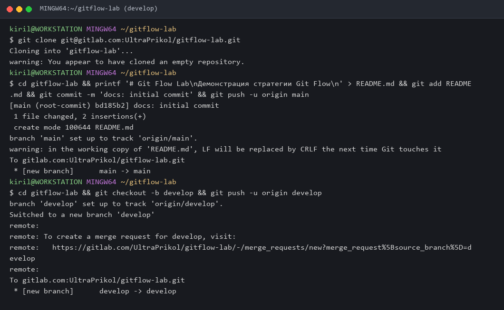
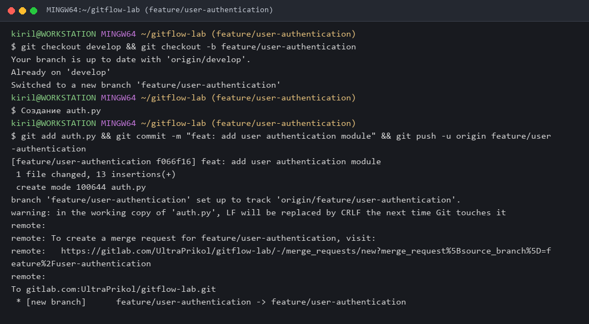
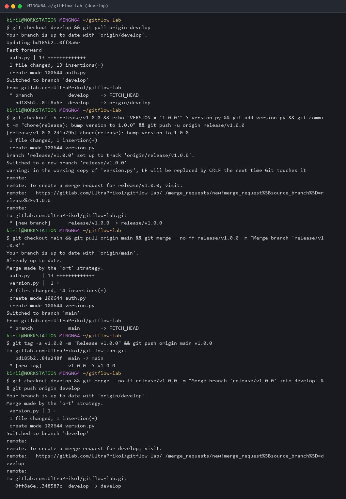
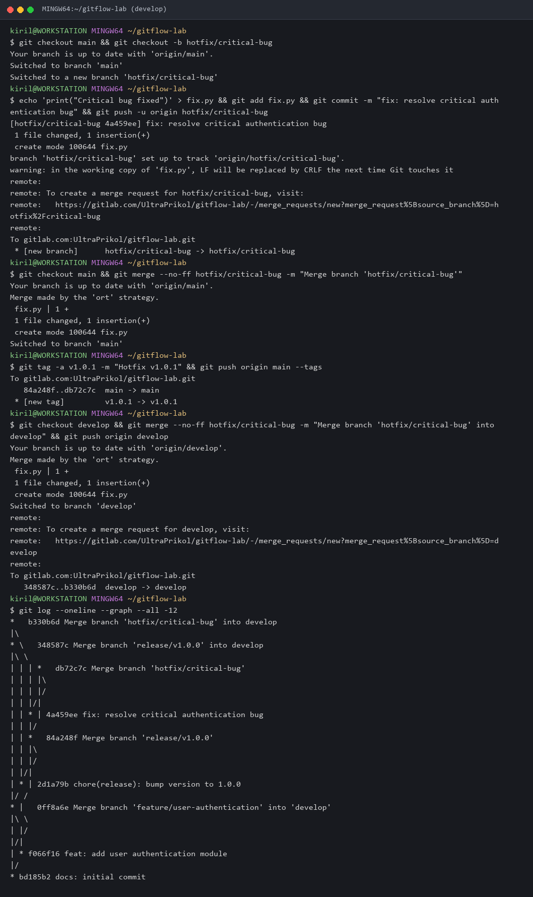
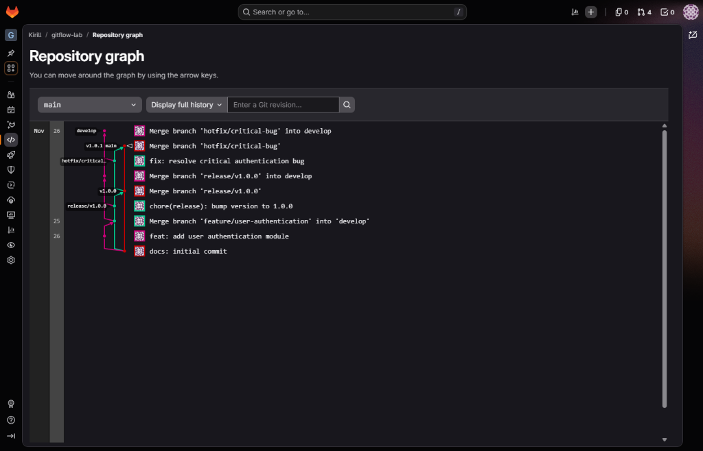
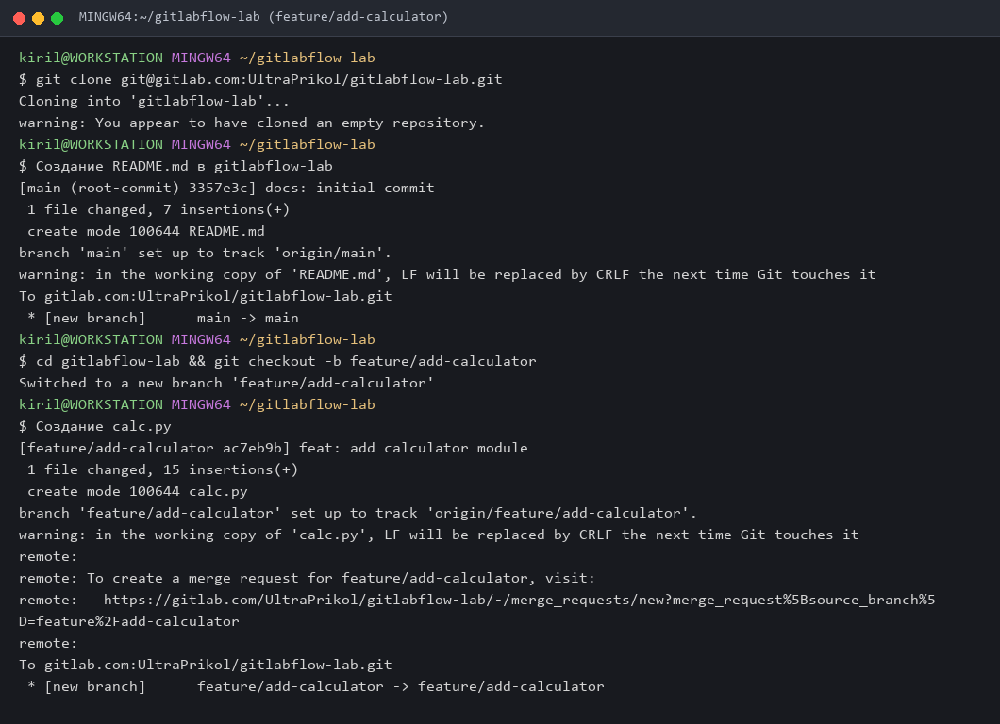
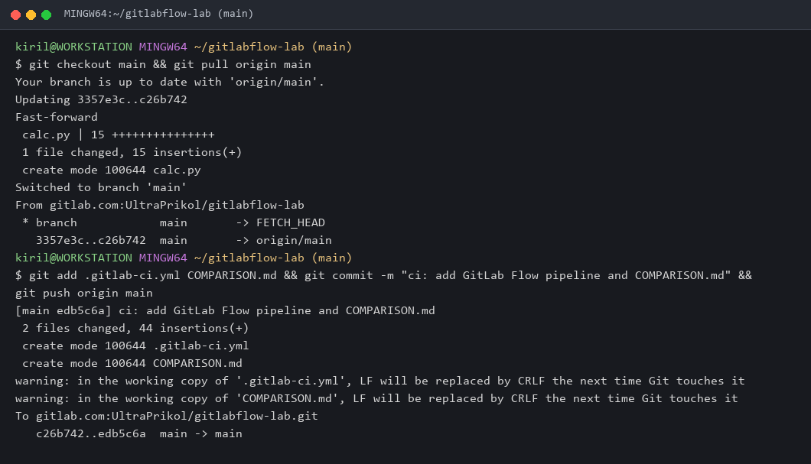

# Отчет по лабораторной работе 0902
# Лабораторная работа 9: Стратегии ветвления в команде. Git Flow, GitLab Flow и Trunk-based Development

**Дата:** 2026-11-13
**Семестр:** 5
**Группа:** ПИН-б-о-24-1
**Дисциплина:** Системы управления версий
**Студент:** Манжура Кирилл Владимирович

## 1. Цель работы

1. Изучить три ключевые стратегии командного ветвления: **Git Flow**, **GitLab Flow** и **Trunk-based Development**.
2. Сравнить стратегии по сложности, релизному циклу, работе с hotfix и применимости в проектах.
3. Практически реализовать полный цикл **Git Flow** (`main`, `develop`, `feature/*`, `release/*`, `hotfix/*`, теги релизов).
4. Практически реализовать **GitLab Flow** (`main`, `feature/*`, Merge Request и окружения `staging`/`production` в CI/CD).
5. Подготовить сравнительную таблицу и рекомендации по выбору стратегии.

---

## 2. Требования к окружению

| Компонент | Версия / Источник |
|:---|:---|
| **Операционная система** | Windows 11 (Git Bash / MINGW64) |
| **Git** | `git version 2.53.0.windows.2` |
| **Python** | `Python 3.13.5` |
| **GitLab** | Репозитории `UltraPrikol/gitflow-lab` и `UltraPrikol/gitlabflow-lab` |
| **GitLab Runner** | Проектный `gitlab-runner 19.6.1` (`shell / bash`) |

---

## 3. Теоретическое введение

| Стратегия | Основные ветки | Релизный цикл | Применение |
|:---|:---|:---|:---|
| **Git Flow** | `main`, `develop`, `feature/*`, `release/*`, `hotfix/*` | Плановые версионируемые релизы | Крупные продукты с фиксированными релизами |
| **GitLab Flow** | `main`, `feature/*` + окружения `staging`/`production` | Непрерывная доставка (CD) | Веб-сервисы и SaaS с развитым CI/CD |
| **Trunk-based** | Одна ветка `main` + короткие ветки (1–2 дня) | Непрерывный деплой | Стартапы, микросервисы, feature-флаги |

---

## 4. Ход выполнения работы

### Часть 1 — Реализация Git Flow

#### Шаг 1–2. Создание `gitflow-lab`, ветки `develop` и настройка защиты веток

На GitLab создан публичный проект `UltraPrikol/gitflow-lab`, инициализирован `README.md` в `main`, от него создана и отправлена ветка `develop`. Настроена защита веток `main` (`Maintainers`) и `develop` (`Developers + Maintainers`):

#### Шаг 3–4. Разработка в `feature/user-authentication` и слияние MR в `develop`

От `develop` создана ветка `feature/user-authentication`, реализован модуль `auth.py` (`login`, `logout`, `register`), ветка отправлена в `origin`, открыт и слит в `develop` Merge Request `!1` (`0ff8a6e`):

#### Шаг 5–6. Релизная ветка `release/v1.0.0`, слияние в `main` и `develop`, тег `v1.0.0`

От `develop` создана ветка `release/v1.0.0`, добавлен файл `version.py` (`VERSION = '1.0.0'`, коммит `2d1a79b`), ветка слита в `main` с аннотированным тегом `v1.0.0` и обратно в `develop`:

#### Шаг 7. Срочное исправление `hotfix/critical-bug` и тег `v1.0.1`

От `main` создана ветка `hotfix/critical-bug` (`fix.py`, коммит `4a459ee`), затем исправление слито в `main` с тегом `v1.0.1` и в `develop` (`b330b6d`):

На графе репозитория GitLab (`/-/network/main`) видны все ветки (`main`, `develop`, `release/v1.0.0`, `hotfix/critical-bug`) и релизные теги `v1.0.0`, `v1.0.1`:

---

### Часть 2 и 3 — Реализация GitLab Flow и сравнение стратегий

#### Шаг 8–13. Проект `gitlabflow-lab`, MR в `main`, CI/CD окружения и `COMPARISON.md`

Создан проект `UltraPrikol/gitlabflow-lab` (подключён раннер `60155444`), создана ветка `feature/add-calculator` с классом `Calculator` (`calc.py`), открыт и слит в `main` MR `!1` (`c26b742`):

Добавлены `.gitlab-ci.yml` (`test` с проверкой `Calculator`, автоматический `deploy_staging` и ручной `deploy_production`) и файл `COMPARISON.md` со сравнительной таблицей стратегий. Пайплайн `#3116379779` успешно выполнил `test` и `deploy_staging`, остановившись перед ручным `deploy_production`:

---

## 5. Сравнительная таблица стратегий

| Критерий | Git Flow | GitLab Flow | Trunk-based Development |
|:---|:---|:---|:---|
| **Основные ветки** | `main` + `develop` | `main` (+ окружения) | `main` |
| **Feature-ветки** | От `develop` | От `main` | От `main` (до 1–2 дней) |
| **Релизные ветки** | `release/*` | Нет (используются теги/ветки окружений) | Нет |
| **Hotfix-ветки** | `hotfix/*` от `main` | Через feature-ветку или cherry-pick | Фикс в `main` / cherry-pick |
| **История коммитов** | Разветвлённая, много merge | Более линейная | Максимально линейная |
| **Сложность** | Высокая | Средняя | Низкая |
| **Подходит для** | Крупные продукты с версиями | Веб-приложения, SaaS, DevOps | Стартапы, микросервисы |

---

## 6. Ответы на контрольные вопросы

1. **Какие основные ветки существуют в Git Flow?**  
   Две постоянные ветки: `main` (код в продакшене, всегда стабилен) и `develop` (интеграционная ветка для подготовки следующего релиза).

2. **Для чего нужна ветка `develop` в Git Flow?**  
   `develop` служит основной веткой разработки, куда сливаются завершённые `feature/*`-ветки и где накапливаются изменения до момента формирования очередного релиза.

3. **Как создаётся и сливается релизная ветка?**  
   Она ответвляется от `develop` (`release/v1.0.0`), в ней выполняются тестирование, багфиксы и поднятие версии, после чего она сливается и в `main` (с установкой тега версии), и обратно в `develop` (чтобы багфиксы не потерялись).

4. **В чём отличие hotfix от feature-ветки?**  
   `feature/*` создаётся от `develop` для новой функциональности и сливается обратно в `develop`. `hotfix/*` создаётся от `main` для срочного исправления критической ошибки на продакшене и сливается одновременно в `main` (с новым patch-тегом) и в `develop`.

5. **Какие ветки существуют в GitLab Flow?**  
   Одна главная ветка `main`, короткие `feature/*`-ветки от `main` и (при необходимости) ветки/окружения развёртывания (`staging`, `production`).

6. **Как организован деплой на staging в GitLab Flow?**  
   При попадании изменений из MR в `main` (или в ветку `staging`) автоматически запускается CI/CD-джоба `deploy_staging` с блоком `environment: name: staging`, выкладывающая свежую сборку на тестовый стенд.

7. **В чём суть Trunk-based Development?**  
   Все разработчики работают вокруг единой основной ветки `main` (trunk), создавая очень короткие ветки или коммитя небольшими порциями в `main` по несколько раз в день при строгом автоматическом тестировании.

8. **Какие преимущества дают feature-флаги в Trunk-based?**  
   Feature flags (feature toggles) позволяют вливать ещё незавершённую функциональность в `main` в выключенном состоянии, избегая долгоживущих веток, сложных конфликтов слияния и позволяя безопасно включать или откатывать фичу без повторного деплоя.

9. **Какую стратегию вы выберете для стартапа и почему?**  
   Для небольшого стартапа (до 5 человек) оптимален **Trunk-based Development** (или упрощённый **GitLab Flow**): минимум накладных расходов на управление ветками, быстрая доставка фич пользователям и тесная интеграция с CI/CD.

10. **В каких случаях стоит использовать Git Flow?**  
    Когда у проекта крупная команда (>10 человек), строгие плановые релизные циклы, необходимость поддерживать несколько версий продукта одновременно (например, десктопное/мобильное ПО или коробочные корпоративные решения) и отдельная QA-команда на релиз-кандидатах.

---

## 7. Выводы

В ходе лабораторной работы №9 практически реализованы и проверены на GitLab две ключевые стратегии ветвления: полный цикл **Git Flow** (`gitflow-lab` с ветками `main`, `develop`, `feature/*`, `release/v1.0.0`, `hotfix/critical-bug` и тегами `v1.0.0`, `v1.0.1`) и **GitLab Flow** (`gitlabflow-lab` с CI/CD окружениями `staging` и `production`), а также выполнен сравнительный анализ с **Trunk-based Development**.
