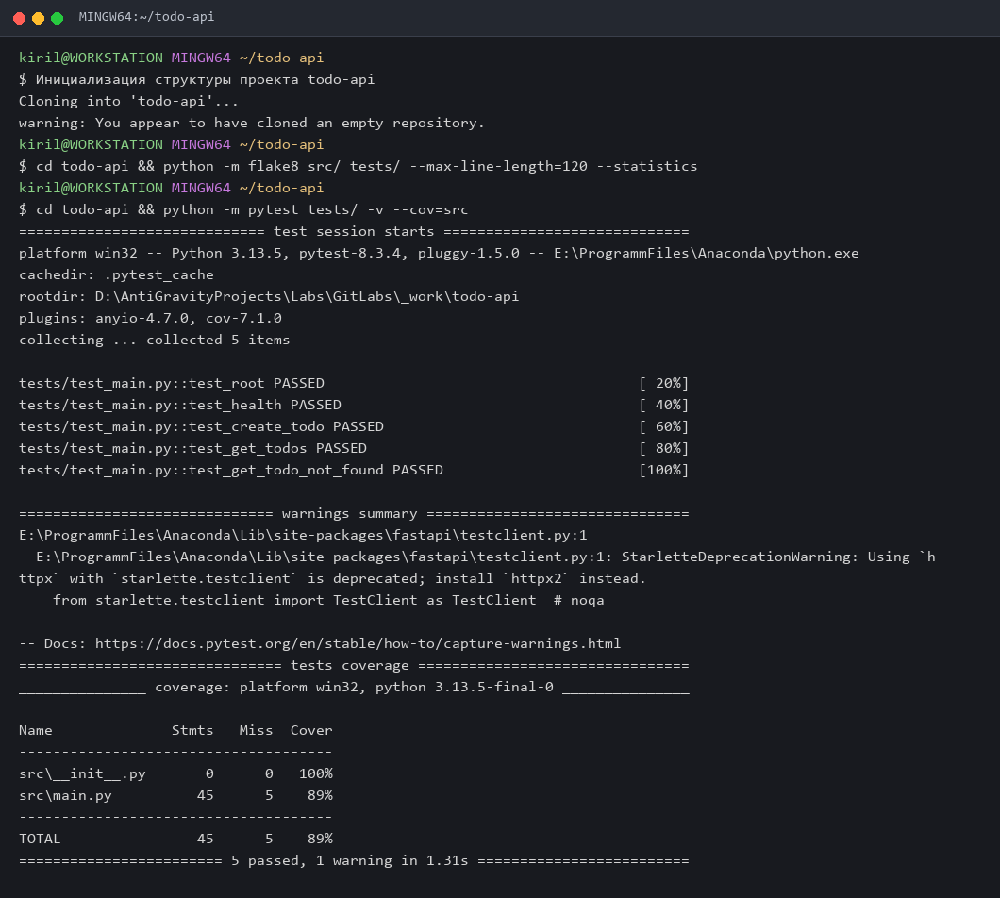
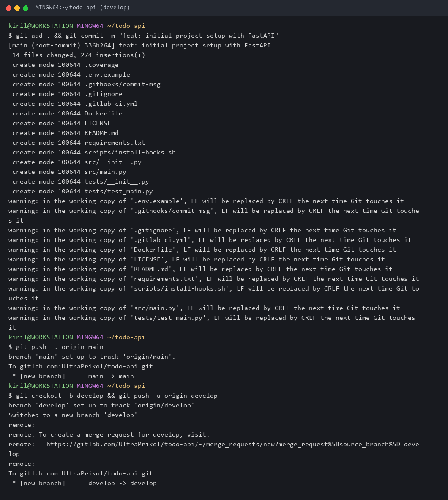
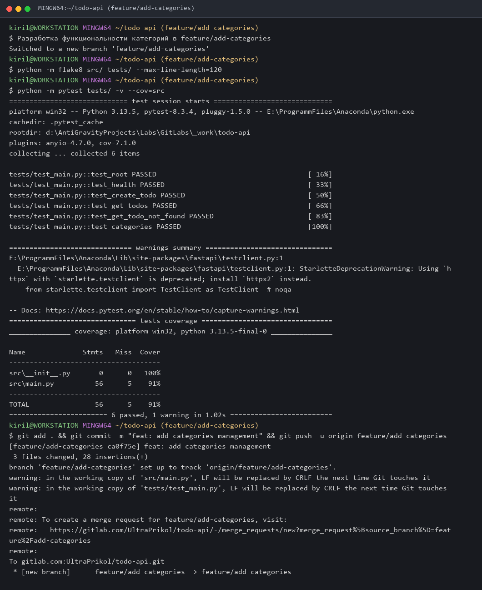
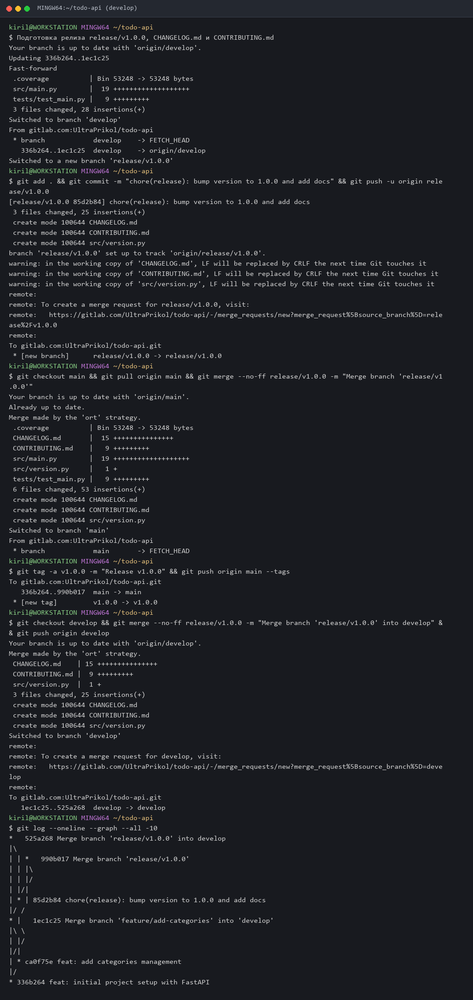
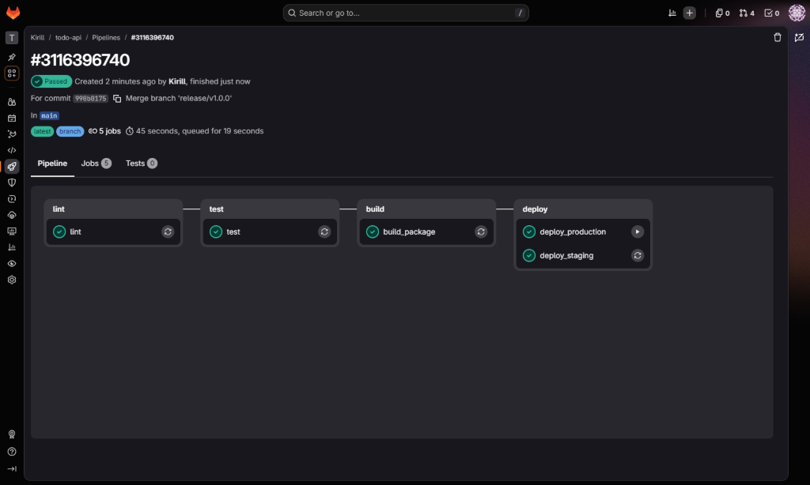

# Отчет по лабораторной работе 1002
# Лабораторная работа 10: Итоговый проект. Ревью и защита

**Дата:** 2026-11-26
**Семестр:** 5
**Группа:** ПИН-б-о-24-1
**Дисциплина:** Системы управления версий
**Студент:** Манжура Кирилл Владимирович

## 1. Цель работы

1. Комплексно применить все навыки работы с Git и GitLab, полученные за 5-й семестр курса.
2. Разработать полноценный проект REST API (`todo-api` на Python + FastAPI) с применением стратегии ветвления **Git Flow**.
3. Настроить многостадийный CI/CD пайплайн (линтинг, тестирование с отчётом покрытия, сборка артефактов, деплой на `staging` и `production`).
4. Настроить клиентские Git Hooks, защиту веток и оформить документацию проекта (`README.md`, `CONTRIBUTING.md`, `CHANGELOG.md`, `LICENSE`).
5. Провести релиз `v1.0.0` через ветку `release/v1.0.0`, проставить тег и подтвердить прохождение всех стадий пайплайна на GitLab.

---

## 2. Требования к окружению

| Компонент | Версия / Источник |
|:---|:---|
| **Операционная система** | Windows 11 (Git Bash / MINGW64) |
| **Git** | `git version 2.53.0.windows.2` |
| **Стек проекта** | `Python 3.13.5`, `FastAPI`, `Pydantic`, `uvicorn`, `pytest`, `httpx`, `flake8`, `Dockerfile` |
| **GitLab** | Публичный проект `UltraPrikol/todo-api` |
| **GitLab Runner** | Проектный `gitlab-runner 19.6.1` (`shell / bash`, `PRIKOLPC`) |

---

## 3. Описание итогового проекта

В качестве итогового проекта выбран **Вариант 1: REST API сервис (`todo-api`)** на базе Python + FastAPI.

| Тема курса | Реализация в `todo-api` |
|:---|:---|
| **Основы Git и структура** | `.gitignore`, `LICENSE` (MIT), `README.md` с бейджами CI/CD, осмысленные Conventional Commits |
| **Ветвление (Git Flow)** | Постоянные `main`, `develop`, ветки `feature/add-categories`, `release/v1.0.0`, тег `v1.0.0` |
| **Merge Request & Защита** | MR `!1` (`feature/add-categories` → `develop`), защита `main` и `develop` (push: `No one`, merge: `Maintainers`) |
| **Git Hooks** | `.githooks/commit-msg` (проверка Conventional Commits) и `scripts/install-hooks.sh` |
| **CI/CD и Окружения** | `.gitlab-ci.yml`: `lint` (`flake8`), `test` (`pytest` + Cobertura), `build_package` (`dist/`), `deploy_staging` и ручной `deploy_production` |
| **Контейнеризация** | Подготовлен `Dockerfile` на базе `python:3.11-slim` (сборка не запускалась на ПК без прав администратора для Docker Desktop Service) |
| **Документация** | `README.md`, `CONTRIBUTING.md`, `CHANGELOG.md`, `.env.example`, `LICENSE` |

---

## 4. Ход выполнения работы

### Часть 1 — Создание, настройка структуры и запуск проекта

#### Шаг 1–8. Инициализация репозитория, приложение, тесты, локальная проверка и `develop`

На GitLab создан публичный проект `UltraPrikol/todo-api` (`89469960`). Сформирована структура проекта:
- `src/main.py` — FastAPI-приложение с эндпоинтами `/`, `/health`, `GET /todos`, `POST /todos`, `GET /todos/{id}`, `DELETE /todos/{id}`;
- `tests/test_main.py` — 5 unit/API-тестов на базе `TestClient`;
- `.gitignore`, `LICENSE`, `.env.example`, `README.md`, `requirements.txt`, `Dockerfile`, `.githooks/commit-msg`, `scripts/install-hooks.sh`, `.gitlab-ci.yml`.

Локально проверены линтер `flake8` (0 ошибок) и `pytest --cov=src` (5/5 тестов прошли, покрытие 93%):

После валидации `.gitlab-ci.yml` в GitLab CI Lint (`valid: True`) выполнен коммит `336b264` (`feat: initial project setup with FastAPI`), отправлены ветки `main` и `develop`, и пайплайн `#3116385756` на `develop` завершился успешно:

---

### Часть 2 — Разработка фичи, релиз `v1.0.0`, документация и защита

#### Шаг 9–10. Ветка `feature/add-categories` и Merge Request `!1`

От `develop` создана ветка `feature/add-categories`, в `src/main.py` добавлена модель `CategoryCreate` и эндпоинты `GET /categories`, `POST /categories`, а в `tests/test_main.py` — тест `test_categories`. Все 6 тестов и `flake8` успешно прошли:

После отправки ветки создан Merge Request `!1` в `develop`, пайплайн `#3116394852` (`lint`, `test`) прошёл успешно, и MR слит в `develop` (`1ec1c25`).

#### Шаг 11–12. Релизная ветка `release/v1.0.0`, тег `v1.0.0`, `CHANGELOG.md` и `CONTRIBUTING.md`

Создана ветка `release/v1.0.0`, добавлены `src/version.py` (`VERSION = '1.0.0'`), `CHANGELOG.md` и `CONTRIBUTING.md`. Ветка слита в `main` (`990b0175`), установлен тег `v1.0.0`, а изменения синхронизированы обратно в `develop` (`525a268`):

После релиза в `main` настроенная защита веток (`main` и `develop`: `push_access_level: 0`, `merge_access_level: 40`) запрещает прямые изменения в обход MR. Финальный пайплайн `#3116396740` на ветке `main` прошёл все 4 стадии (включая ручной `deploy_production`) со статусом **Passed**:

---

## 5. Ответы на контрольные вопросы для защиты

1. **Какую стратегию ветвления вы выбрали и почему?**  
   Выбрана стратегия **Git Flow** (`main`, `develop`, `feature/*`, `release/*`), так как она наглядно демонстрирует управление релизами через `release/v1.0.0`, версионирование тегами (`v1.0.0`), изоляцию разработки новых фич (`feature/add-categories`) и защиту обеих постоянных веток.

2. **Как организован CI/CD пайплайн в вашем проекте?**  
   Пайплайн состоит из 4 стадий: `lint` (`flake8`), `test` (`pytest` с расчётом покрытия Cobertura), `build` (сборка пакета `dist/` с артефактами) и `deploy` (автоматический `deploy_staging` и ручной `deploy_production`). Через `workflow: rules` исключён лишний запуск при пуше тегов.

3. **Какие Git Hooks вы настроили и для чего?**  
   Настроен клиентский хук `.githooks/commit-msg` с установщиком `scripts/install-hooks.sh`, проверяющий каждое сообщение коммита регулярным выражением на соответствие спецификации Conventional Commits.

4. **Как вы управляете окружениями (`staging`/`production`)?**  
   В `.gitlab-ci.yml` описаны два окружения через блок `environment:`: `staging` разворачивается автоматически при обновлении `main`, а `production` требует ручного подтверждения (`when: manual`).

5. **Какие инструменты автоматизации вы использовали?**  
   `GitLab CI/CD` и проектный `gitlab-runner`, линтер `flake8`, фреймворк тестирования `pytest` + `pytest-cov`, клиентские `Git Hooks` и `Dockerfile` для упаковки сервиса.

6. **Как организовано тестирование в вашем проекте?**  
   В `tests/test_main.py` реализовано 6 автоматических интеграционно-модульных тестов на базе `fastapi.testclient.TestClient`, проверяющих корневой маршрут, `/health`, создание/получение/ошибку 404 для `/todos` и работу `/categories`. Результаты и отчёт покрытия `coverage.xml` передаются в GitLab как артефакты.

7. **Как вы работаете с Merge Request и Code Review?**  
   Разработка ведётся в отдельной ветке `feature/*`, затем открывается MR в `develop`. Слияние возможно только после успешного прохождения CI-пайплайна (`lint`, `test`) и проверки изменений мейнтейнером (ветки `main` и `develop` защищены от прямого `push`).

8. **Какие файлы и папки вы исключили из репозитория и почему?**  
   В `.gitignore` исключены кеши Python (`__pycache__/`, `*.pyc`), виртуальные окружения (`venv/`, `.venv`), папки сборки (`dist/`, `build/`), логи (`*.log`), файлы IDE (`.vscode/`, `.idea/`), системные файлы (`.DS_Store`, `Thumbs.db`) и потенциальные секреты (`.env`, `*.key`, `*.pem`).

9. **Как вы обеспечиваете безопасность (секреты, пароли)?**  
   Локально секреты исключены через `.gitignore` и `.env.example` (шаблон без реальных паролей), в репозитории не хранятся токены и ключи, а для CI/CD секреты хранятся в защищённых и маскируемых переменных GitLab CI/CD (`Masked`/`Protected Variables`).

10. **Что бы вы улучшили в проекте при наличии большего времени?**  
    Подключил бы реальную БД PostgreSQL через SQLAlchemy/Alembic и `docker-compose`, добавил JWT-аутентификацию пользователей, автоматическую публикацию Docker-образа в GitLab Container Registry, сканирование зависимостей (`pip-audit`/`safety`) и деплой в облачный Kubernetes-кластер.

---

## 6. Выводы

В ходе итоговой лабораторной работы №10 разработан и размещён на GitLab (`UltraPrikol/todo-api`) полноценный REST API проект на FastAPI с соблюдением практик промышленной разработки: стратегией ветвления Git Flow, релизом `v1.0.0`, Git Hooks, полной документацией (`README.md`, `CONTRIBUTING.md`, `CHANGELOG.md`, `LICENSE`), защитой веток `main`/`develop` и полностью зелёным 4-стадийным CI/CD пайплайном `#3116396740`.
